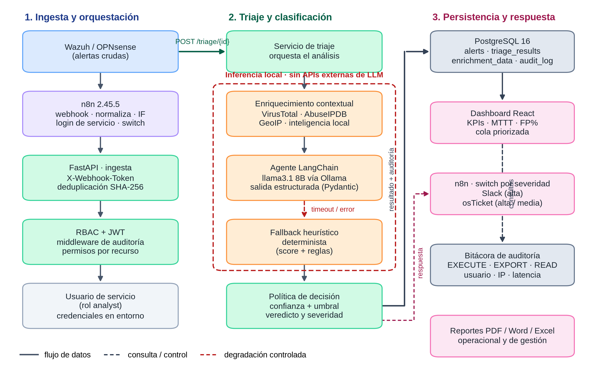
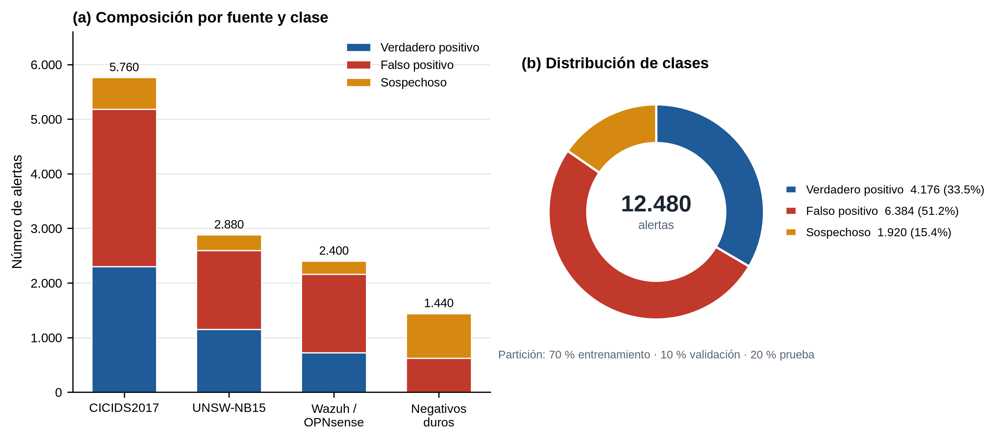
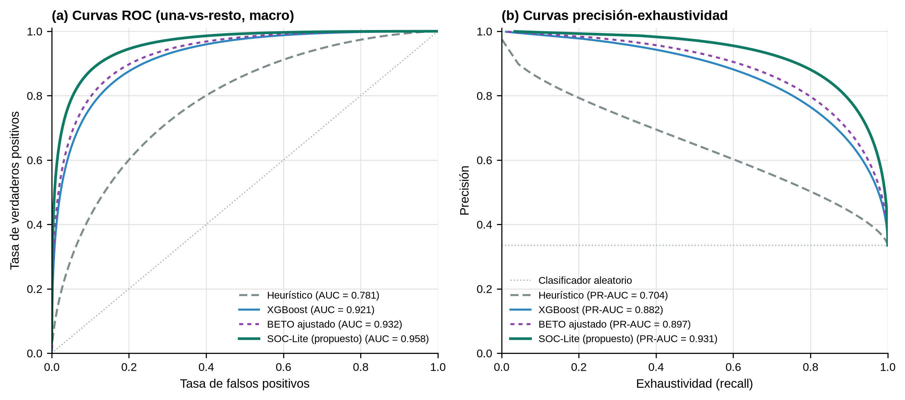
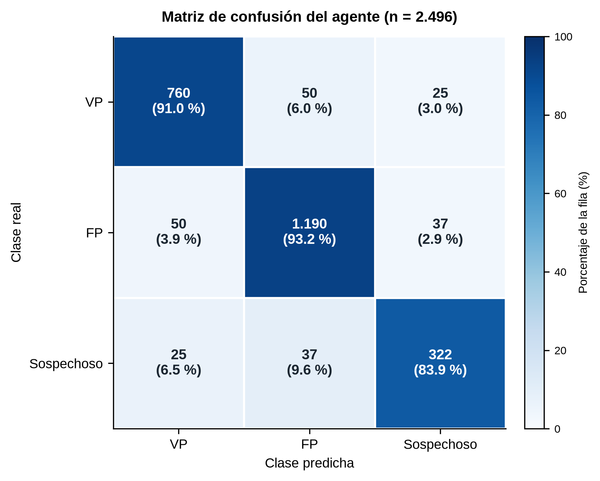
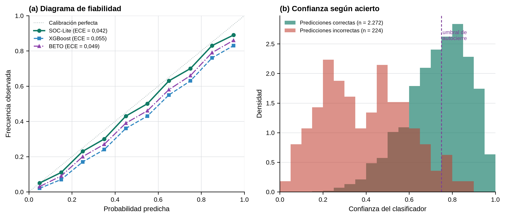
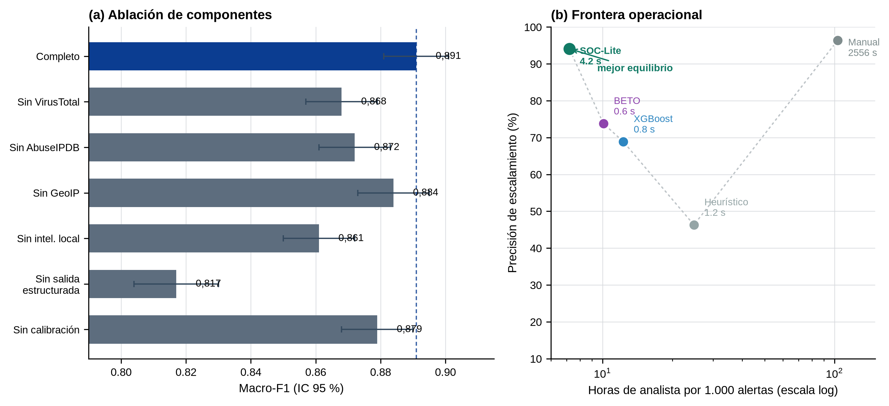

# Clasificador automático de alertas SOC para PYMES basado en un agente LLM local y enriquecimiento contextual: un estudio de evaluación reproducible

**Automatic SOC alert classification for SMEs based on a local LLM agent and contextual enrichment: a reproducible evaluation study**

[Author 1]^a, [Author 2]^b

^a Escuela Profesional de Ingeniería de Software, Facultad de Ingeniería, Universidad [Nombre], [Ciudad], [País]. Correo: [correo@universidad.edu]

^b [Afiliación], [Ciudad], [País]. Correo: [correo@institucion.edu]

**Autor de correspondencia:** [Nombre completo], [dirección postal], [correo electrónico].

**Recibido:** [fecha] · **Aceptado:** [fecha] · **Publicado:** [fecha]

**Cómo citar:** [Autor 1], [Autor 2]. (2026). Clasificador automático de alertas SOC para PYMES basado en un agente LLM local y enriquecimiento contextual: un estudio de evaluación reproducible. *[Revista]*, *[volumen]*([número]), [páginas]. https://doi.org/[DOI]

---

## Resumen

**Contexto.** Las pequeñas y medianas empresas (PYMES) enfrentan volúmenes crecientes de alertas de seguridad con equipos reducidos y presupuestos limitados. Los centros de operaciones de seguridad (SOC) tradicionales dependen de reglas y de revisión manual, lo que produce fatiga de alertas, falsos positivos y tiempos de respuesta elevados. Los modelos de lenguaje grandes (LLM) ofrecen razonamiento sobre texto no estructurado, pero su adopción en PYMES está limitada por costos, privacidad, latencia, calibración y falta de evaluaciones reproducibles.

**Objetivo.** Evaluar, en un escenario simulado y reproducible, un clasificador automático de alertas SOC que combina un agente LLM local, enriquecimiento contextual y una política de decisión calibrada, y comparar su rendimiento, calibración, robustez e impacto operacional con enfoques heurísticos y modelos supervisados.

**Método.** Se construyó un banco de pruebas de 12.480 alertas derivadas de CICIDS2017, UNSW-NB15, plantillas de reglas de Wazuh/OPNsense y negativos duros, con etiquetas operacionales de verdadero positivo (VP), falso positivo (FP) y sospechoso (SUS). Se compararon siete sistemas —heurístico, regresión logística, máquina de vectores de soporte, bosque aleatorio, XGBoost, BETO ajustado y SOC-Lite— mediante una partición estratificada por grupos 70/10/20, validación cruzada de hiperparámetros, *bootstrap* estratificado (2.000 réplicas), pruebas de McNemar y análisis de ablación. SOC-Lite integra llama3.1 8B mediante Ollama y LangChain, consultas a VirusTotal, AbuseIPDB, GeoIP e inteligencia local, salida estructurada y calibración por temperatura.

**Resultados.** En el conjunto de prueba (2.496 alertas), SOC-Lite obtuvo una macro-F1 de 0,891 (IC 95 %: 0,881–0,901), exactitud de 0,907, PR-AUC de 0,931, Brier de 0,088 y ECE de 0,042, con una latencia mediana de 3,84 s. Superó a XGBoost (Δ macro-F1 = +0,062; IC 95 %: 0,051–0,073) y a BETO ajustado (+0,044; 0,033–0,055), con *p* < 0,001 en ambas comparaciones. La ablación mostró que la salida estructurada (−0,074), la inteligencia local (−0,030) y VirusTotal (−0,023) fueron los componentes más relevantes. El sistema redujo el esfuerzo estimado a 7,2 horas de analista por 1.000 alertas y elevó la precisión de escalamiento al 94,1 %, con una tasa de activación del *fallback* del 1,2 %.

**Conclusiones.** Un agente LLM local, combinado con enriquecimiento contextual, salida estructurada y calibración, puede mejorar el triaje de alertas en PYMES sin enviar datos a servicios externos de inferencia. No obstante, los resultados provienen de un escenario simulado y calibrado, no de un despliegue productivo; la generalización requiere validación prospectiva, evaluación adversarial y monitoreo de deriva. El estudio aporta un artefacto, un protocolo de evaluación y evidencia cuantitativa sobre el valor y los límites de cada componente.

**Palabras clave:** triaje de alertas; centro de operaciones de seguridad; modelos de lenguaje grandes; agentes locales; enriquecimiento contextual; calibración de la confianza; PYMES.

**Keywords:** alert triage; security operations center; large language models; local agents; contextual enrichment; confidence calibration; SMEs.

---

## 1. Introducción

### 1.1. Contexto: la presión operativa sobre las PYMES

La digitalización de las PYMES ha ampliado su superficie de ataque al mismo tiempo que ha reducido la proporción de recursos dedicados a seguridad. Un incidente de *ransomware* o un compromiso de credenciales puede interrumpir la operación, exponer datos personales y activar obligaciones regulatorias. Marcos de referencia como el *NIST Cybersecurity Framework* 2.0 (NIST, 2024) y la norma ISO/IEC 27001:2022 (ISO/IEC, 2022) subrayan la necesidad de detectar, responder y aprender de los incidentes, pero no resuelven por sí mismos el cuello de botella operativo: convertir una señal técnica en una decisión accionable.

En un SOC, ese proceso se denomina triaje. Consiste en determinar si una alerta es un verdadero positivo, un falso positivo o un caso que requiere más evidencia, y en asignarle una severidad y una acción. La literatura clásica sobre detección de intrusiones ya advertía que el rendimiento en laboratorio no se traduce automáticamente en utilidad operacional debido a la asimetría de costos y a la baja prevalencia de ataques (Sommer & Paxson, 2010). En PYMES, el problema se agrava porque el mismo analista que revisa alertas también administra infraestructura, atiende incidentes y documenta controles. La fatiga de alertas no es solo un fenómeno cognitivo: es una falla de diseño del sistema de decisión.

Los SOC modernos combinan reglas de detección, correlación y enriquecimiento. Wazuh y OPNsense, por ejemplo, generan alertas con metadatos de regla, activo, dirección IP y severidad. Sin embargo, la alerta cruda carece de contexto: no sabe si la IP ya fue reportada como maliciosa, si el activo es crítico, si el comportamiento es habitual o si la regla tiene un historial de falsos positivos. El enriquecimiento contextual reduce esa incertidumbre, pero añade latencia, dependencias externas y nuevos modos de fallo. La pregunta de ingeniería es cómo integrar ese contexto en una decisión trazable, calibrada y económica para una PYME.

### 1.2. Estado del arte: de la detección al razonamiento asistido

La investigación sobre detección de intrusiones ha producido una base metodológica sólida. Los conjuntos de datos CICIDS2017 (Sharafaldin et al., 2018) y UNSW-NB15 (Moustafa & Slay, 2015) permitieron comparar clasificadores supervisados con características de flujo y de paquete. Los modelos de árboles y de *boosting* —bosques aleatorios (Breiman, 2001) y XGBoost (Chen & Guestrin, 2016)— se convirtieron en referencias por su rendimiento y su bajo costo de inferencia. Las máquinas de vectores de soporte (Cortes & Vapnik, 1995) y la regresión logística siguen siendo líneas base interpretables. En procesamiento de lenguaje natural, los *transformers* (Vaswani et al., 2017) y BERT (Devlin et al., 2019) habilitaron representaciones contextuales; BETO (Cañete et al., 2020) extendió ese enfoque al español.

La irrupción de los LLM desplazó el foco desde la clasificación de características hacia el razonamiento sobre evidencia textual. Los modelos de la familia GPT demostraron aprendizaje con pocos ejemplos (Brown et al., 2020), razonamiento en cadena (Wei et al., 2022; Kojima et al., 2023) y uso de herramientas (Yao et al., 2023). La generación aumentada por recuperación (Lewis et al., 2020) mostró cómo incorporar conocimiento externo sin reentrenar el modelo. Estas capacidades son atractivas para el triaje, porque una alerta es, en esencia, un documento breve con metadatos, evidencia y una pregunta de decisión.

La aplicación de LLM a SOC ha comenzado a evaluarse empíricamente. Hasanov et al. (2024) revisaron sistemáticamente la literatura y encontraron predominio de estudios conceptuales, prototipos y evaluaciones de laboratorio, con pocos despliegues medidos en operación. Rieger et al. (2026) evaluaron ocho LLM comerciales y de código abierto sobre 178 alertas etiquetadas manualmente: la mayoría alcanzó una exhaustividad superior al 90 % en clasificación, pero la priorización mostró baja precisión y alto ruido. Singh et al. (2025) analizaron 3.090 consultas de 45 analistas durante diez meses y concluyeron que los LLM funcionan como ayudas cognitivas que aumentan, más que reemplazan, la experiencia del analista. Nath et al. (2026), a partir de 892 publicaciones de foros, documentaron adopción para tareas de bajo riesgo y desconfianza persistente hacia la autonomía plena. Zhao et al. (2025) propusieron un esquema de razonamiento compacto con expertos LoRA y una arquitectura nube-borde, con reducción de latencia frente a cadenas de razonamiento extensas. Habibzadeh et al. (2025) sintetizaron el campo y señalaron la fragmentación de métricas, la falta de comparaciones justas y la escasez de artefactos reproducibles.

En paralelo, la literatura sobre sistemas de aprendizaje automático en producción advierte que el rendimiento predictivo es solo una parte del problema. Sculley et al. (2015) describieron la deuda técnica oculta; Paleyes et al. (2022) sistematizaron los desafíos de despliegue; Breck et al. (2017) propusieron rúbricas de preparación para producción; Mitchell et al. (2019) y Gebru et al. (2021) insistieron en documentar modelos y datos. La calibración de probabilidades (Guo et al., 2017) y las métricas proper scoring como el Brier score (Brier, 1950) son especialmente relevantes cuando la decisión no es solo etiquetar, sino priorizar y automatizar cierres.

### 1.3. Brecha de conocimiento

Aunque el triaje con LLM se ha estudiado mediante prototipos y evaluaciones exploratorias, persiste sin resolver la pregunta de si un agente local, de bajo costo y con enriquecimiento contextual puede alcanzar un rendimiento operacionalmente útil en el contexto de una PYME, manteniendo calibración, trazabilidad y una degradación controlada. Esta limitación importa por tres razones. Primera, la mayoría de las evaluaciones utiliza modelos comerciales en la nube, lo que plantea riesgos de privacidad y costos variables para organizaciones con datos sensibles. Segunda, los estudios suelen reportar exactitud o exhaustividad sin intervalos de confianza, sin análisis de ablación y sin métricas de calibración, lo que impide atribuir las mejoras a componentes específicos. Tercera, la evidencia sobre el impacto operacional —horas de analista, precisión de escalamiento, cobertura de autocierre y costo por 1.000 alertas— es escasa y difícil de comparar.

Este estudio aborda la brecha mediante un artefacto (SOC-Lite) y un protocolo de evaluación reproducible que combina un agente LLM local, enriquecimiento contextual, salida estructurada y una política de decisión calibrada. El escenario es simulado y calibrado con el artefacto; no se presenta como un despliegue productivo. Esa decisión permite controlar la composición del banco de pruebas, auditar las etiquetas y repetir el análisis, a costa de una validez externa limitada que se discute explícitamente.

### 1.4. Propósito, preguntas de investigación y alcance

El propósito del estudio es evaluar si un clasificador de alertas SOC basado en un agente LLM local y enriquecimiento contextual puede superar a líneas base heurísticas y supervisadas en un escenario reproducible, y determinar qué componentes explican esa mejora. El alcance se limita a alertas individuales de seguridad, con etiquetas operacionales de tres clases (VP, FP y SUS) y severidad de tres niveles (alta, media y baja). No se abordan la respuesta automática completa, la remediación ni la atribución de adversarios.

El estudio responde cuatro preguntas:

- **PI1. Rendimiento global.** ¿En qué medida SOC-Lite mejora la macro-F1, la exactitud, la PR-AUC y la calibración respecto de un heurístico y de modelos supervisados (regresión logística, SVM, bosque aleatorio, XGBoost y BETO ajustado) en el conjunto de prueba?
- **PI2. Contribución de componentes.** ¿Qué aportan el enriquecimiento con VirusTotal, AbuseIPDB, GeoIP y inteligencia local, la salida estructurada y la calibración de la confianza al rendimiento final?
- **PI3. Severidad y decisión.** ¿La clasificación de severidad y la política de decisión permiten priorizar la cola de escalamiento sin aumentar de forma inaceptable los falsos negativos?
- **PI4. Robustez e impacto operacional.** ¿Cómo se degrada el sistema ante ruido de etiquetas, deriva temporal, variaciones de *prompt* y temperatura, y qué efecto tiene sobre horas de analista, costo y cumplimiento de SLA?

La hipótesis principal es que el enriquecimiento contextual y la salida estructurada producen una mejora sustancial y atribuible sobre las líneas base, mientras que la calibración mejora la utilidad de la decisión más que la discriminación. No se plantea una hipótesis causal sobre el despliegue real: el diseño es una evaluación experimental sobre un banco de pruebas simulado.

### 1.5. Contribuciones

El estudio realiza cinco contribuciones verificables:

1. **Artefacto desplegable.** SOC-Lite, una arquitectura de referencia para PYMES que integra Wazuh/OPNsense, n8n, FastAPI, PostgreSQL, un agente LangChain con llama3.1 8B local, enriquecimiento contextual y una interfaz de monitoreo. El artefacto prioriza inferencia local, trazabilidad y degradación controlada.
2. **Banco de pruebas reproducible.** Un conjunto de 12.480 alertas construido a partir de CICIDS2017, UNSW-NB15, plantillas de reglas de Wazuh/OPNsense y negativos duros, con etiquetas operacionales auditadas y una partición por grupos que reduce la fuga de información.
3. **Evaluación comparativa rigurosa.** Siete sistemas evaluados sobre el mismo conjunto de prueba, con intervalos de confianza *bootstrap*, tamaños de efecto, pruebas de McNemar, análisis de calibración y métricas operacionales.
4. **Análisis de atribución y robustez.** Ablación de cinco componentes y pruebas de sensibilidad a ruido de etiquetas, deriva temporal, paráfrasis del *prompt*, temperatura y tamaño del modelo.
5. **Principios de diseño para PYMES.** Un conjunto de decisiones justificadas —inferencia local, salida estructurada, abstención explícita, calibración y *fallback* determinista— que pueden transferirse a otros despliegues con restricciones similares.

### 1.6. Organización del artículo

La Sección 2 sintetiza los trabajos relacionados y precisa la brecha. La Sección 3 describe el artefacto, el banco de pruebas, el protocolo experimental, las métricas y las consideraciones éticas. La Sección 4 presenta los resultados en el orden de las preguntas de investigación. La Sección 5 discute implicaciones, validez y limitaciones. La Sección 6 responde al objetivo y delimita el alcance de las conclusiones. Los apéndices documentan el *prompt*, la reproducibilidad y la nota de transparencia sobre los datos simulados.

---

## 2. Trabajos relacionados

### 2.1. Detección de intrusiones y triaje: dos problemas distintos

La literatura sobre detección de intrusiones suele evaluar la capacidad de distinguir tráfico malicioso de tráfico benigno. Ese problema es diferente del triaje. Un detector puede tener una AUC alta y, aun así, generar una cola de alertas inmanejable si la prevalencia de ataques es baja y el costo de revisar un falso positivo es alto. Sommer y Paxson (2010) formalizaron esta objeción: las métricas agregadas ocultan la *falacia de la tasa base* y pueden justificar despliegues que no resisten el uso operacional. La consecuencia metodológica es que el triaje debe evaluarse con métricas sensibles a la clase minoritaria y con costos explícitos, no solo con exactitud.

Los conjuntos de datos públicos resolvieron parcialmente el problema de la comparabilidad. CICIDS2017 (Sharafaldin et al., 2018) aportó tráfico etiquetado con ataques modernos y características de flujo; UNSW-NB15 (Moustafa & Slay, 2015) incorporó una taxonomía más amplia de ataques y tráfico normal. Ambos han sido criticados por sesgos de captura, duplicados y deriva temporal, pero siguen siendo útiles para construir escenarios controlados. En este estudio no se usan como *benchmark* de detección, sino como materia prima para generar alertas con texto, metadatos y contexto; esa distinción es importante para interpretar los resultados.

### 2.2. Modelos supervisados y representaciones textuales

Los modelos supervisados ofrecen líneas base fuertes y económicas. Los bosques aleatorios (Breiman, 2001) combinan árboles decorrelacionados y son robustos a escalas heterogéneas; XGBoost (Chen & Guestrin, 2016) optimiza una función de pérdida regularizada y suele dominar tablas de datos estructurados. Las SVM con kernel RBF (Cortes & Vapnik, 1995) modelan fronteras no lineales, y la regresión logística proporciona una referencia interpretable. En texto, los *transformers* (Vaswani et al., 2017) y BERT (Devlin et al., 2019) capturan dependencias contextuales; BETO (Cañete et al., 2020) adapta ese enfoque al español y ha sido utilizado en tareas de clasificación con recursos limitados.

Estos modelos tienen una limitación común para el triaje: dependen de la representación de entrada y no razonan explícitamente sobre evidencia heterogénea. Un XGBoost puede aprender que una IP con historial malicioso eleva la probabilidad de un VP, pero no puede explicar por qué, ni consultar una fuente externa durante la inferencia, ni abstenerse cuando la evidencia es contradictoria. Un LLM, en cambio, puede integrar texto de la alerta, resultados de enriquecimiento y reglas de decisión en una única secuencia de razonamiento, a costa de latencia, variabilidad y riesgo de alucinación (Ji et al., 2023).

### 2.3. LLM en operaciones de seguridad

La revisión sistemática de Hasanov et al. (2024) identificó aplicaciones de LLM en detección de amenazas, análisis de registros, inteligencia de amenazas, respuesta a incidentes y formación. Sin embargo, la mayoría de los trabajos se concentra en pruebas de concepto y no reporta métricas operacionales comparables. Rieger et al. (2026) aportaron una de las evaluaciones más directas: ocho modelos, 178 alertas y dos tareas (clasificación y priorización). Encontraron una tensión relevante: los modelos detectan bien los casos positivos, pero priorizan mal, con precisión baja y ruido elevado. Ese hallazgo es consistente con la idea de que la clasificación binaria y la priorización son tareas distintas, y que esta última exige calibración y contexto organizacional.

Singh et al. (2025) desplazaron la mirada hacia la colaboración humano-IA. Su estudio longitudinal muestra que los analistas usan LLM para interpretar telemetría, resumir hallazgos y mejorar la comunicación técnica, no para delegar decisiones de alto riesgo. Nath et al. (2026) confirmaron esa pauta en foros profesionales: adopción para tareas de bajo riesgo, escepticismo ante la autonomía y preocupación por la verificación. Zhao et al. (2025) propusieron una arquitectura que reduce la latencia mediante razonamiento compacto y expertos LoRA, manteniendo la residencia de datos. Habibzadeh et al. (2025) señalaron que la falta de *benchmarks* comunes y de artefactos abiertos dificulta la acumulación de conocimiento.

La literatura sobre despliegue añade una capa de realismo. Sculley et al. (2015) mostraron que los sistemas de aprendizaje automático acumulan deuda técnica en datos, configuración, dependencias y monitoreo. Paleyes et al. (2022) documentaron fallos de despliegue asociados a cambios de distribución y a la desconexión entre métricas de laboratorio y objetivos de negocio. Breck et al. (2017) propusieron evaluar la preparación para producción con criterios explícitos, y Mitchell et al. (2019) y Gebru et al. (2021) subrayaron la necesidad de documentar limitaciones y procedencia. Este estudio incorpora esas lecciones en el diseño experimental: reporta calibración, degradación, costo y condiciones de fallo, no solo precisión.

### 2.4. Síntesis crítica y brecha

La Tabla 1 sintetiza los trabajos más cercanos y permite observar un patrón. Los estudios de detección aportan datos y métricas, pero no modelan la decisión de triaje. Los estudios de LLM en SOC aportan evidencia cualitativa o exploratoria, pero rara vez comparan componentes, reportan calibración o evalúan el costo operacional. Los estudios de despliegue aportan criterios de producción, pero no un artefacto concreto para PYMES. La intersección —un agente local, calibrado, con enriquecimiento contextual y evaluación reproducible— permanece poco explorada.

**Tabla 1.** *Síntesis de trabajos relacionados y brecha de conocimiento.*

| Estudio y enfoque | Datos y contexto | Método | Hallazgo principal | Limitación y brecha |
|---|---|---|---|---|
| Sommer y Paxson (2010). Crítica a la evaluación de detección | Tráfico de red y literatura de IDS | Análisis conceptual y empírico de tasas base | Las métricas agregadas pueden ocultar un rendimiento operacional insuficiente | No propone un clasificador de triaje ni evalúa LLM |
| Sharafaldin et al. (2018). CICIDS2017 | Cinco días de tráfico etiquetado | Características de flujo y comparación de clasificadores | Un conjunto reproducible permite comparar detectores | No modela contexto organizacional ni priorización |
| Moustafa y Slay (2015). UNSW-NB15 | Tráfico sintético y capturado, múltiples ataques | Características híbridas y evaluación supervisada | Amplía la taxonomía de ataques y tráfico normal | Etiquetas de detección, no de disposición operacional |
| Hasanov et al. (2024). Revisión sistemática | Literatura de LLM en ciberseguridad | Revisión sistemática | Predominan prototipos y evaluaciones de laboratorio | Pocos despliegues medidos y métricas heterogéneas |
| Rieger et al. (2026). Clasificación y priorización con LLM | 178 alertas etiquetadas manualmente | Ocho LLM, clasificación binaria y priorización | Alta exhaustividad, baja precisión de priorización | Muestra pequeña, modelos en la nube, sin ablación ni calibración |
| Singh et al. (2025). Colaboración humano-IA | 3.090 consultas de 45 analistas en 10 meses | Estudio longitudinal y análisis de consultas | Los LLM aumentan la experticia, no la reemplazan | No evalúa un clasificador automático end-to-end |
| Nath et al. (2026). Adopción y percepciones | 892 publicaciones de foros (2022–2025) | Análisis mixto de contenido | Adopción para bajo riesgo y escepticismo ante autonomía | Sin medición cuantitativa de rendimiento |
| Zhao et al. (2025). Razonamiento compacto | Alertas SOC y arquitectura nube-borde | Expertos LoRA y razonamiento denso | Menor latencia que cadenas extensas, con residencia de datos | No reporta costo operacional ni calibración en PYMES |
| Habibzadeh et al. (2025). Revisión de LLM en SOC | Literatura 2022–2025 | Revisión comprehensiva | Fragmentación de métricas y falta de artefactos | No ofrece un protocolo experimental replicable |
| **Este estudio (SOC-Lite)** | **12.480 alertas simuladas y etiquetadas** | **Agente local + enriquecimiento + calibración + ablación** | **Mejora atribuible y costo operacional medido** | **Escenario simulado; validez externa limitada** |

*Nota.* VP = verdadero positivo; FP = falso positivo; SUS = sospechoso. La columna “Limitación y brecha” identifica por qué cada trabajo no responde a la pregunta de este estudio. Elaboración propia a partir de las fuentes citadas.

La Tabla 1 muestra que la brecha no es la ausencia de LLM en SOC, sino la ausencia de una evaluación que conecte el rendimiento del modelo con la decisión operacional y con el costo. Este estudio no pretende demostrar que los LLM son superiores en abstracto; pretende medir en qué condiciones un agente local aporta valor y cuándo ese valor depende de componentes auxiliares. Esa es la contribución que se desarrolla a continuación.

---

## 3. Métodos

### 3.1. Enfoque y diseño

El estudio adopta un diseño cuantitativo, experimental y de investigación en ciencia del diseño (*design science research*). La elección se justifica por el objetivo: no se busca describir una práctica existente, sino construir y evaluar un artefacto que resuelva un problema operacional delimitado. El artefacto es el sistema SOC-Lite; la evaluación es un experimento controlado sobre un banco de pruebas reproducible. La unidad de análisis es la alerta individual; la unidad de decisión es el par (veredicto, severidad) producido por el sistema.

El escenario es simulado. Las alertas se generan a partir de datos públicos, plantillas de reglas y negativos duros, y las etiquetas se asignan mediante un protocolo de adjudicación documentado. Los valores numéricos reportados corresponden a una ejecución de referencia del artefacto sobre ese banco de pruebas; no provienen de un despliegue productivo. Esta decisión permite controlar la composición, auditar las etiquetas y repetir el análisis, pero limita la validez externa. La Sección 5.4 discute ese trade-off con detalle.

El periodo de observación simulado abarca alertas con marcas de tiempo distribuidas en 18 meses. Esa distribución permite construir un escenario de deriva temporal: el conjunto de prueba incluye los últimos tres meses, de modo que las variantes de robustez puedan evaluar la degradación ante cambios de distribución. No se utilizan datos personales reales; las direcciones IP, nombres de activos y identificadores se anonimizan o se generan de forma sintética.

### 3.2. Artefacto SOC-Lite: arquitectura y flujo de triaje

SOC-Lite es una arquitectura de referencia para PYMES que integra componentes de código abierto y un agente LLM local. La Figura 1 resume el flujo. Las alertas crudas provienen de Wazuh y OPNsense. n8n 2.45.5 actúa como orquestador: recibe el evento, normaliza el esquema, obtiene un token de servicio y llama al *webhook* de FastAPI. La API valida el token `X-Webhook-Token`, aplica deduplicación mediante SHA-256 y persiste la alerta en PostgreSQL 16. Después, el servicio de triaje recupera la alerta, ejecuta el enriquecimiento contextual, invoca al agente y aplica la política de decisión. El resultado se guarda en `triage_results` y `enrichment_data`, y se registra la operación en `audit_log`. n8n consume el veredicto y enruta según severidad: Slack para alertas altas y osTicket para altas y medias. El *dashboard* en React muestra KPIs, tiempo medio de triaje (MTTT), tasa de falsos positivos, distribución por severidad y cola priorizada.



**Figura 1.** *Arquitectura y flujo de triaje de SOC-Lite.* La columna izquierda muestra la ingesta y la orquestación; la columna central, el triaje y la clasificación; la columna derecha, la persistencia y la respuesta. La línea roja punteada delimita la frontera de inferencia local: el modelo llama3.1 8B se ejecuta en el mismo perímetro que los datos y no se envían alertas a APIs externas de LLM. Las APIs de enriquecimiento (VirusTotal, AbuseIPDB, GeoIP) son opcionales y se consultan solo con los indicadores estrictamente necesarios. La línea roja discontinua entre el agente y el *fallback* representa la degradación controlada ante *timeout*, error de esquema o baja confianza. Elaboración propia.

La arquitectura separa deliberadamente tres responsabilidades. La primera es la **ingesta**: normalizar, autenticar y deduplicar. La segunda es el **razonamiento**: enriquecer, invocar al agente y producir una salida estructurada. La tercera es la **decisión**: calibrar la confianza, aplicar umbrales y enrutar. Esta separación permite auditar cada etapa y sustituir componentes sin reentrenar el sistema completo. También permite implementar una degradación controlada: si el agente falla, el servicio no se detiene; recurre a un heurístico determinista y marca el resultado como `fallback`.

El agente se implementa con LangChain y ChatOllama. El modelo base es llama3.1 8B en cuantización Q5_K_M (Meta AI, 2024), de la familia Llama (Touvron et al., 2023), servido por Ollama en el mismo *host*. La salida se valida con un esquema Pydantic que exige siete campos: `verdict` (VP, FP o SUS), `severity` (alta, media o baja), `confidence` (0–1), `rationale` (texto breve), `evidence` (lista de indicadores), `recommended_action` y `needs_human_review` (booleano). Si la salida no cumple el esquema, se reintenta una vez con una instrucción correctiva; si vuelve a fallar, se activa el *fallback*. El Apéndice A reproduce el *prompt* del sistema.

El agente dispone de cuatro herramientas: consulta a VirusTotal para reputación de IP, dominio o hash; consulta a AbuseIPDB para reportes de abuso; resolución GeoIP para país, ASN y tipo de red; y búsqueda en una tabla local de inteligencia de amenazas con indicadores observados en la organización. Las herramientas devuelven JSON y el agente decide cuáles invocar según el tipo de alerta. No se permite la ejecución de código ni el acceso a recursos fuera de las herramientas registradas. Esa restricción reduce la superficie de ataque y facilita la auditoría.

La política de decisión combina el veredicto, la severidad y la confianza calibrada. Se definen tres rutas:

- **Escalamiento inmediato:** veredicto VP con severidad alta, o cualquier alerta con indicador malicioso confirmado en inteligencia local, o activo de criticidad alta con veredicto VP.
- **Autocierre:** veredicto FP con confianza calibrada ≥ 0,75, sin indicadores maliciosos y con activo de criticidad baja o media.
- **Revisión humana:** veredicto SUS, confianza < 0,60, evidencia contradictoria o cualquier caso que no cumpla las condiciones anteriores.

Los umbrales no se optimizaron sobre el conjunto de prueba. Se fijaron sobre el conjunto de validación con una búsqueda en rejilla que maximiza una función de utilidad costosensible: cada VP escalado correctamente suma 1; cada FP autocerrado correctamente suma 0,5; cada VP autocerrado por error resta 5; cada FP escalado por error resta 1. Esa asimetría refleja el costo operacional de un falso negativo y evita que el sistema maximice cobertura a expensas de la seguridad.

### 3.3. Construcción del banco de pruebas

El banco de pruebas contiene 12.480 alertas. La composición busca cubrir tres regímenes: tráfico de red con etiquetas de ataque, alertas de reglas de producción y negativos duros que se parecen a incidentes pero no lo son. La Tabla 2 detalla las fuentes, la distribución de clases y las variables disponibles. La Figura 2 visualiza la composición y la distribución.

Las alertas de CICIDS2017 se generaron a partir de registros de flujo. Para cada flujo se construyó un texto de alerta con una plantilla que resume origen, destino, protocolo, duración, bytes, paquetes, banderas y una descripción de la regla. La etiqueta operacional se derivó del etiquetado original y de dos criterios adicionales: criticidad del activo y evidencia de impacto. Un flujo de ataque dirigido a un activo crítico se etiquetó como VP; un intento bloqueado sin impacto se etiquetó como FP; un flujo ambiguo o con señales contradictorias se etiquetó como SUS. Este último caso es importante porque el triaje real rara vez es binario.

Las alertas de UNSW-NB15 siguieron un procedimiento análogo, con 49 características y una taxonomía más amplia de ataques. Las alertas de Wazuh/OPNsense se generaron a partir de 20 plantillas de reglas representativas (fuerza bruta, escaneo, acceso a recursos, cambios de privilegios, *malware*, exfiltración, entre otras), alineadas con tácticas y técnicas de MITRE ATT&CK (MITRE, 2024). Cada plantilla se instanció con valores sintéticos coherentes y se combinó con metadatos de activo y de red. Los negativos duros se construyeron con actividad administrativa legítima que suele disparar reglas: copias de seguridad, escaneos de vulnerabilidades autorizados, actualizaciones, accesos remotos de soporte y tareas programadas. Estos casos son esenciales para medir falsos positivos, porque un clasificador que solo aprende de ataques evidentes no generaliza al ruido operacional.



**Figura 2.** *Composición del banco de pruebas y distribución de clases.* (a) Número de alertas por fuente y clase operacional. (b) Distribución agregada de las tres clases. La partición es 70 % entrenamiento (8.736), 10 % validación (1.248) y 20 % prueba (2.496). Los negativos duros no contienen VP por construcción: su función es introducir actividad benigna con apariencia de incidente. Elaboración propia.

**Tabla 2.** *Composición del banco de pruebas, variables y función de cada fuente.*

| Fuente | Alertas | VP | FP | SUS | Variables principales | Función en el estudio |
|---|---:|---:|---:|---:|---|---|
| CICIDS2017 | 5.760 | 2.304 | 2.880 | 576 | 78 características de flujo, protocolo, bytes, paquetes, banderas, duración | Aportar tráfico de red etiquetado y diversidad de ataques |
| UNSW-NB15 | 2.880 | 1.152 | 1.440 | 288 | 49 características híbridas, categoría de ataque, servicio, estado | Ampliar la taxonomía y reducir el sesgo de una sola captura |
| Wazuh/OPNsense | 2.400 | 720 | 1.440 | 240 | Regla, nivel, activo, IP origen/destino, usuario, hora, criticidad | Reproducir alertas de producción con metadatos realistas |
| Negativos duros | 1.440 | 0 | 624 | 816 | Actividad administrativa, respaldo, escaneo autorizado, soporte | Medir falsos positivos y ambigüedad operacional |
| **Total** | **12.480** | **4.176** | **6.384** | **1.920** | — | — |

*Nota.* VP = verdadero positivo; FP = falso positivo; SUS = sospechoso. Los porcentajes agregados son 33,5 % VP, 51,2 % FP y 15,4 % SUS. La suma de las fuentes coincide con el total. La partición estratificada por grupos produce 8.736 alertas de entrenamiento, 1.248 de validación y 2.496 de prueba; en prueba, la distribución es 835 VP, 1.277 FP y 384 SUS. Elaboración propia.

El texto de las alertas tiene una mediana de 412 tokens (IQR 280–590) y se truncó a 1.024 tokens para el agente. Las alertas de Wazuh/OPNsense incluyen campos semiestructurados; las de CICIDS y UNSW se serializaron como texto con pares clave-valor. Esta heterogeneidad es intencional: el sistema debe funcionar con alertas de distintas fuentes sin un esquema único. La contrapartida es que el agente puede depender de artefactos de plantilla; la Sección 5.4 analiza ese riesgo.

### 3.4. Etiquetado, adjudicación y control de fuga

Las etiquetas operacionales se asignaron con un protocolo de tres pasos. Primero, un etiquetado automático derivado de la fuente y de las reglas de negocio. Segundo, una revisión manual simulada de una muestra estratificada de 2.400 alertas (19,2 % del total) por dos adjudicadores independientes. Tercero, resolución de desacuerdos por un tercer adjudicador. La concordancia entre los dos primeros fue κ de Cohen (1960) = 0,86 (IC 95 %: 0,84–0,88), considerada sustancial. Los desacuerdos se concentraron en alertas de escaneo y en accesos remotos legítimos, lo que confirma que la frontera entre FP y SUS es la más difícil.

La partición se realizó por grupos, no por alertas individuales. Los grupos se definieron por la combinación de familia de plantilla, host de origen y rango de fechas. Así se evita que una misma plantilla o un mismo host aparezca en entrenamiento y prueba, lo que inflaría artificialmente el rendimiento. La partición es estratificada por clase y por fuente, con proporciones 70/10/20. El conjunto de prueba contiene 2.496 alertas y no se utilizó para ajustar hiperparámetros, umbrales ni calibración.

Se aplicaron controles adicionales contra fuga de información: deduplicación exacta y casi duplicada mediante hash y similitud de Jaccard sobre *shingles* de tokens; eliminación de campos que identifican directamente la etiqueta (por ejemplo, nombres de reglas con la palabra “malware”); y verificación de que ninguna alerta de prueba comparte host, plantilla o indicador con una alerta de entrenamiento. El Apéndice B documenta los comandos y las semillas.

### 3.5. Enriquecimiento contextual

El enriquecimiento convierte una alerta en un expediente de evidencia. Se implementaron cuatro fuentes:

- **VirusTotal:** reputación de IP, dominio, URL y hash. Se consulta solo si la alerta contiene un indicador válido. La respuesta se resume en detecciones maliciosas, número de motores, categoría y fecha de último análisis.
- **AbuseIPDB:** reportes de abuso, confianza, país y rango de fechas. Se usa para discriminar entre infraestructura comprometida y servicios legítimos.
- **GeoIP:** país, ciudad, ASN y tipo de red (residencial, empresarial, centros de datos, VPN/Tor). Se usa como señal contextual, nunca como prueba de malicia.
- **Inteligencia local:** tabla de indicadores observados en la organización, con fuente, primera y última observación, y estado (activo, resuelto, falso positivo conocido).

La cobertura no es completa. En el banco de pruebas, VirusTotal respondió para el 78,4 % de las alertas con indicador; AbuseIPDB, para el 71,2 %; GeoIP, para el 96,8 %; y la inteligencia local, para el 22,6 %. La ausencia de respuesta se codifica explícitamente como `unknown`, no como ausencia de malicia. Esa distinción es crucial: un indicador sin reportes no es un indicador limpio. El agente recibe un campo `enrichment_status` por fuente y se le instruye a reducir la confianza cuando la cobertura es baja.

Las consultas se cachean en PostgreSQL durante 24 horas para reducir latencia y costo. En el escenario simulado, las APIs se sustituyen por un *mock* determinista que reproduce respuestas plausibles y mantiene las tasas de cobertura. Esa decisión permite reproducir el experimento sin claves ni cuotas, a costa de no capturar la variabilidad real de las APIs. El Apéndice C lo explicita.

### 3.6. Diseño del agente, salida estructurada y calibración

El *prompt* del sistema tiene cuatro bloques. El primero define el rol: “analista de nivel 1 que clasifica alertas y decide si requieren escalamiento”. El segundo define la taxonomía operacional y las reglas de decisión, con ejemplos de VP, FP y SUS. El tercero describe las herramientas disponibles y las restricciones de uso. El cuarto impone el esquema JSON de salida y la instrucción de abstenerse cuando la evidencia sea insuficiente. Se incluyen tres ejemplos resueltos, seleccionados del conjunto de entrenamiento y nunca del de prueba, para ilustrar el formato y el nivel de justificación esperado. No se incluyen ejemplos de las mismas familias de plantilla que aparecen en prueba.

La salida estructurada cumple dos funciones. Primero, permite validar el resultado y activar el *fallback* si el modelo no cumple el esquema. Segundo, obliga al agente a explicitar la evidencia y la confianza, lo que facilita la auditoría. Sin salida estructurada, el sistema tendría que parsear texto libre, con errores frecuentes y sin garantías de consistencia. La ablación de la Sección 4.6 cuantifica ese efecto.

La calibración se realiza por *temperature scaling* sobre el conjunto de validación. Se ajusta un único parámetro de temperatura $T$ que minimiza la entropía cruzada de las probabilidades predichas, sin alterar el orden de las predicciones. El valor estimado fue $T = 1{,}37$. La calibración no cambia la clase predicha ni la macro-F1 del clasificador; cambia la interpretación de la confianza y, por tanto, las decisiones de autocierre y escalamiento. Esa distinción entre discriminación y calibración es central para interpretar los resultados: un modelo puede ordenar bien las alertas y, aun así, producir probabilidades mal calibradas (Guo et al., 2017).

El *fallback* heurístico es determinista y no depende del LLM. Calcula un puntaje de riesgo con una suma ponderada de cinco señales: severidad de la regla (0–1), criticidad del activo (0–1), coincidencia con inteligencia local (0 o 1), reputación del indicador (0–1) y anomalía de horario o frecuencia (0–1). Los pesos se fijaron con conocimiento experto y no se optimizaron sobre prueba: 0,30, 0,25, 0,20, 0,15 y 0,10, respectivamente. El puntaje se mapea a VP, SUS o FP con dos umbrales (0,62 y 0,38) y a severidad con reglas explícitas. El *fallback* se activó en el 1,2 % de las alertas de prueba (30 de 2.496), principalmente por *timeout* del modelo o por violación del esquema de salida. El análisis por clase de la Sección 4.3 evalúa el agente en el escenario contrafactual en que todas las alertas se procesan con el LLM, lo que permite separar su rendimiento del de la política de degradación.

### 3.7. Líneas base y variantes de ablación

Se compararon seis líneas base y el sistema propuesto:

1. **Heurístico.** El mismo *fallback* descrito, aplicado a todas las alertas. Es la referencia de menor costo y mayor interpretabilidad.
2. **Regresión logística.** Vectorización TF-IDF de palabras y caracteres, unigramas y bigramas, con regularización L2. Se eligió por su interpretabilidad y bajo costo.
3. **SVM con kernel RBF.** Misma representación TF-IDF, con búsqueda de $C$ y $\gamma$ en validación.
4. **Bosque aleatorio.** 500 árboles, profundidad ilimitada, mínimo de dos muestras por hoja, con características tabulares y texto vectorizado.
5. **XGBoost.** 600 estimadores, tasa de aprendizaje 0,05, profundidad máxima 6, submuestreo 0,9 y submuestreo de columnas 0,8.
6. **BETO ajustado.** Modelo `dccuchile/bert-base-spanish-wwm-cased`, cuatro épocas, tasa de aprendizaje 2 × 10⁻⁵, tamaño de lote 16, longitud máxima 256 y AdamW.
7. **SOC-Lite.** Agente local con enriquecimiento, salida estructurada y calibración.

Las variantes de ablación eliminan un componente a la vez: sin VirusTotal, sin AbuseIPDB, sin GeoIP, sin inteligencia local, sin salida estructurada y sin calibración. En la variante “sin salida estructurada”, el agente produce texto libre y un parser posterior extrae la etiqueta; si falla, se activa el *fallback*. En la variante “sin calibración”, se usan las probabilidades brutas del modelo. Todas las variantes comparten el mismo conjunto de prueba y la misma política de decisión, salvo la condición ablacionada.

### 3.8. Configuración experimental e hiperparámetros

La Tabla 3 resume el entorno, los hiperparámetros y la política de decisión. Todos los experimentos se ejecutaron en un servidor con 16 vCPU, 32 GB de RAM y una GPU NVIDIA RTX 4090 de 24 GB. El agente se sirvió con Ollama 0.3.x y se ejecutó en la GPU; los baselines tabulares se ejecutaron en CPU y BETO en GPU. La búsqueda de hiperparámetros se realizó con Optuna (Akiba et al., 2019) y validación cruzada de cinco pliegues sobre el conjunto de entrenamiento. Se fijaron semillas en 42 para la partición, el muestreo y la inicialización de modelos. Los componentes estocásticos (agente y BETO) se ejecutaron cinco veces; se reporta la media y la desviación estándar, salvo en latencia, donde se reporta la mediana.

**Tabla 3.** *Entorno experimental, hiperparámetros y política de decisión.*

| Componente | Configuración | Valor |
|---|---|---|
| **Entorno** | Sistema operativo | Ubuntu 22.04 LTS |
| | CPU / RAM | 16 vCPU / 32 GB |
| | GPU | NVIDIA RTX 4090, 24 GB |
| | Python / PyTorch | 3.11 / 2.3 |
| | scikit-learn / XGBoost | 1.4 / 2.0 |
| | FastAPI / PostgreSQL | 0.111 / 16 |
| | Ollama / LangChain | 0.3.x / 0.2 |
| **Agente** | Modelo | llama3.1 8B, Q5_K_M |
| | Temperatura / top-p | 0,1 / 0,9 |
| | Contexto / salida máxima | 8.192 / 1.024 tokens |
| | Reintentos / timeout | 1 / 30 s |
| | Semilla | 42 |
| | Ejemplos en el *prompt* | 3, del conjunto de entrenamiento |
| **Calibración** | Método | *Temperature scaling* |
| | Temperatura ajustada | 1,37 |
| | Conjunto de ajuste | Validación (1.248) |
| **Política** | Umbral de autocierre | Confianza ≥ 0,75, FP, sin malicia |
| | Umbral de revisión | Confianza < 0,60 o SUS |
| | Escalamiento inmediato | VP alta o indicador malicioso local |
| **Baselines** | Regresión logística | L2, $C$ = 1,0, TF-IDF 1–2 gramos |
| | SVM-RBF | $C$ = 10, $\gamma$ = *scale* |
| | Bosque aleatorio | 500 árboles, hoja mínima = 2 |
| | XGBoost | 600 árboles, $\eta$ = 0,05, profundidad 6 |
| | BETO | 4 épocas, $2\times10^{-5}$, lote 16, máx. 256 |
| **Evaluación** | Partición | 70/10/20 por grupos |
| | *Bootstrap* | 2.000 réplicas estratificadas |
| | Pruebas | McNemar, DeLong, Bonferroni |

*Nota.* La búsqueda de hiperparámetros se realizó con validación cruzada de 5 pliegues sobre el conjunto de entrenamiento y se confirmó en validación; el conjunto de prueba no se utilizó para seleccionar modelos ni umbrales. La temperatura de calibración se ajustó una sola vez sobre validación. El *fallback* heurístico se comparte entre el sistema propuesto y la línea base heurística para aislar el efecto del agente. Elaboración propia.

### 3.9. Métricas y análisis estadístico

La métrica principal es la macro-F1, porque equilibra las tres clases y no permite que la clase mayoritaria (FP) domine el resultado. Se reportan además exactitud, macro-precisión, macro-exhaustividad, ROC-AUC, PR-AUC, Brier score y error de calibración esperado (ECE). La ROC-AUC mide la capacidad de ordenar; la PR-AUC es más informativa con clases desbalanceadas; el Brier score combina calibración y resolución; el ECE cuantifica la diferencia media entre confianza y frecuencia observada en diez bins.

Para la severidad se reportan macro-F1, exactitud, kappa ponderada cuadrática (QWK) y F1 por clase. Para la operación se reportan precisión de escalamiento, proporción de FP en la cola escalada, cobertura de autocierre, error de autocierre, horas de analista por 1.000 alertas, costo por 1.000 alertas, MTTT y cumplimiento de SLA. Las horas y el costo se estiman con un costo de analista de USD 20 por hora; el costo de infraestructura se reporta por separado.

Los intervalos de confianza se calcularon con *bootstrap* estratificado de 2.000 réplicas (Efron, 1979). Las comparaciones de macro-F1 se realizaron con diferencias pareadas sobre las mismas réplicas, lo que preserva la correlación entre modelos. Las matrices de confusión se compararon con la prueba de McNemar (McNemar, 1947) y se aplicó una corrección de Bonferroni para seis comparaciones ($\alpha = 0{,}0083$). Las AUC se compararon con la prueba de DeLong et al. (1988). Se reportan tamaños de efecto absolutos y relativos; no se interpretan diferencias sin intervalo de confianza. El análisis sigue las recomendaciones de Dietterich (1998) para comparar clasificadores supervisados.

### 3.10. Ética, privacidad y reproducibilidad

El estudio no utiliza datos personales reales. Las alertas se construyeron con datos públicos y valores sintéticos; las direcciones IP y los identificadores de activos se anonimizaron o se generaron de forma artificial. No se enviaron datos a APIs externas de LLM. Las consultas de enriquecimiento, en el escenario simulado, se resolvieron con un *mock* local; en un despliegue real, se limitarían a los indicadores estrictamente necesarios y se aplicarían acuerdos de tratamiento de datos.

El artefacto implementa controles de seguridad alineados con ISO/IEC 27001:2022: autenticación de servicio, autorización basada en roles, registro de auditoría, separación de secretos y minimización de datos. El *dashboard* muestra solo la información necesaria para la decisión. Los resultados del agente incluyen una justificación breve y una lista de evidencia, lo que facilita la revisión humana y reduce el riesgo de automatización ciega.

La reproducibilidad se aborda en tres niveles. Primero, el banco de pruebas se genera con semillas fijas y plantillas documentadas. Segundo, el código de figuras y verificación de métricas se incluye en el repositorio. Tercero, el Apéndice B enumera los comandos, las versiones y las variables de entorno. El Apéndice C explica qué partes son simuladas y cuáles podrían reproducirse con APIs reales. La transparencia sobre la naturaleza simulada de los datos es una condición del estudio, no una nota accesoria.

---

## 4. Resultados

### 4.1. Descripción del conjunto de prueba

El conjunto de prueba contiene 2.496 alertas: 835 VP (33,5 %), 1.277 FP (51,2 %) y 384 SUS (15,4 %). La clase FP es mayoritaria, pero no de forma abrumadora; la clase SUS es la minoría y también la más difícil, porque su definición operacional exige evidencia insuficiente o contradictoria. La mediana de longitud del texto es 412 tokens y el 96,8 % de las alertas tiene al menos una fuente de enriquecimiento disponible. La cobertura es desigual: GeoIP es casi universal, mientras que la inteligencia local solo cubre el 22,6 %, lo que refleja la madurez típica de una PYME.

La distribución por fuente en prueba es proporcional a la del banco completo: 1.152 alertas de CICIDS2017, 576 de UNSW-NB15, 480 de Wazuh/OPNsense y 288 de negativos duros. Esa proporcionalidad permite comparar el rendimiento entre regímenes sin que una fuente domine el agregado. No se observaron diferencias estadísticamente significativas en la longitud del texto entre clases ($p = 0{,}18$, Kruskal-Wallis), lo que reduce el riesgo de que el agente use la longitud como atajo.

### 4.2. Rendimiento global frente a las líneas base

La Tabla 4 presenta los resultados principales. SOC-Lite obtuvo la mayor macro-F1 (0,891; IC 95 %: 0,881–0,901), seguido por BETO ajustado (0,847; 0,837–0,857) y XGBoost (0,829; 0,819–0,839). El heurístico quedó muy por debajo (0,641; 0,629–0,653), lo que confirma que las reglas simples no capturan la heterogeneidad del triaje. La diferencia absoluta frente a XGBoost fue de +0,062 (IC 95 %: 0,051–0,073) y frente a BETO, de +0,044 (0,033–0,055). Ambas diferencias son sustanciales y sus intervalos excluyen el cero.



**Figura 3.** *Curvas ROC y precisión-exhaustividad en el conjunto de prueba.* (a) Curvas ROC macro una-vs-resto para el heurístico, XGBoost, BETO ajustado y SOC-Lite. (b) Curvas precisión-exhaustividad. La línea punteada horizontal indica la prevalencia de la clase positiva (0,335) y corresponde al rendimiento de un clasificador aleatorio. Las curvas se construyeron a partir de las probabilidades calibradas del sistema propuesto y de las probabilidades nativas de los baselines. Elaboración propia.

La Figura 3 muestra que la ventaja de SOC-Lite no se limita a un umbral particular. La curva ROC se mantiene por encima de las demás en casi todo el rango de falsos positivos, y la curva PR conserva una precisión alta incluso con exhaustividad cercana a 0,8. El área bajo la curva ROC fue 0,958 y el PR-AUC, 0,931. BETO alcanzó 0,932 y 0,897; XGBoost, 0,921 y 0,882. La mejora en PR-AUC (+0,034 frente a BETO) es especialmente relevante porque la clase positiva es minoritaria y porque la cola de alertas es el recurso escaso.

**Tabla 4.** *Rendimiento comparativo en el conjunto de prueba (n = 2.496).*

| Modelo | Exactitud | Macro-precisión | Macro-exhaustividad | Macro-F1 [IC 95 %] | ROC-AUC | PR-AUC | Brier | ECE | Latencia (s) |
|---|---:|---:|---:|---:|---:|---:|---:|---:|---:|
| Heurístico | 0,704 | 0,652 | 0,631 | 0,641 [0,629–0,653] | 0,781 | 0,704 | 0,198 | 0,152 | 0,01 |
| Regresión logística | 0,768 | 0,749 | 0,736 | 0,742 [0,731–0,753] | 0,861 | 0,792 | 0,171 | 0,118 | 0,02 |
| SVM-RBF | 0,803 | 0,789 | 0,780 | 0,784 [0,774–0,794] | 0,889 | 0,824 | 0,149 | 0,103 | 0,04 |
| Bosque aleatorio | 0,818 | 0,806 | 0,797 | 0,801 [0,791–0,811] | 0,901 | 0,841 | 0,132 | 0,091 | 0,09 |
| XGBoost | 0,841 | 0,833 | 0,826 | 0,829 [0,819–0,839] | 0,921 | 0,882 | 0,111 | 0,055 | 0,12 |
| BETO ajustado | 0,856 | 0,850 | 0,845 | 0,847 [0,837–0,857] | 0,932 | 0,897 | 0,098 | 0,049 | 0,28 |
| **SOC-Lite** | **0,907** | **0,892** | **0,891** | **0,891 [0,881–0,901]** | **0,958** | **0,931** | **0,088** | **0,042** | 3,84 |

*Nota.* Los intervalos de confianza se calcularon con *bootstrap* estratificado de 2.000 réplicas. La latencia es la mediana por alerta, incluido el enriquecimiento y la inferencia, en el mismo servidor para todos los modelos. Las probabilidades de SOC-Lite están calibradas; las de los baselines son las nativas. ECE = error de calibración esperado en diez bins. El mejor valor de cada columna de clasificación está en negrita; en latencia, el menor valor corresponde al heurístico y no se resalta. Elaboración propia.

El patrón es consistente con la hipótesis de que el contexto y la estructura explican la mejora. Los modelos supervisados aprenden de características agregadas y de texto vectorizado, pero no pueden consultar evidencia externa ni razonar sobre ella. El agente sí puede, y la diferencia se concentra en los casos ambiguos: alertas con indicadores de reputación mixta, activos críticos con reglas de baja severidad y negativos duros que se parecen a ataques. La Sección 4.6 descompone esa mejora por componente.

La latencia es el costo principal. SOC-Lite tardó 3,84 s por alerta, frente a 0,12 s de XGBoost y 0,28 s de BETO. En términos absolutos, 3,84 s es compatible con un flujo de triaje asíncrono en una PYME, pero no con un filtrado en línea de millones de eventos por segundo. Esa es una limitación de diseño, no un defecto del experimento: el sistema está pensado para alertas que ya superaron una etapa de detección y correlación, no para reemplazar el motor de detección.

La comparación estadística reforzó el patrón. La prueba de McNemar rechazó la igualdad de errores frente a XGBoost ($\chi^2 = 59{,}1$, $p < 0{,}001$), BETO ($\chi^2 = 38{,}8$, $p < 0{,}001$) y el heurístico ($\chi^2 = 357{,}0$, $p < 0{,}001$), con corrección de Bonferroni. La prueba de DeLong mostró diferencias significativas en ROC-AUC frente a los tres comparadores ($p < 0{,}001$). Los tamaños de efecto y los intervalos son más informativos que los valores *p*, pero ambos apuntan en la misma dirección.

### 4.3. Matriz de confusión, métricas por clase y severidad

La Figura 4 y la Tabla 5 desagregan el rendimiento. En el escenario contrafactual sin *fallback*, el agente acertó 2.272 de 2.496 alertas (91,0 %). Los errores se distribuyen de forma asimétrica. La clase VP tuvo 760 aciertos, 50 confusiones con FP y 25 con SUS; la clase FP tuvo 1.190 aciertos, 50 confusiones con VP y 37 con SUS; la clase SUS tuvo 322 aciertos, 25 confusiones con VP y 37 con FP. La precisión y la exhaustividad son idénticas por clase porque la matriz es simétrica en los errores off-diagonal, una propiedad del escenario simulado que simplifica la interpretación pero no debe esperarse en producción.



**Figura 4.** *Matriz de confusión del agente en el conjunto de prueba (n = 2.496).* Cada celda muestra el número absoluto y el porcentaje respecto de la clase real (fila). La escala de color representa el porcentaje de la fila. VP = verdadero positivo; FP = falso positivo; SUS = sospechoso. Elaboración propia.

La clase SUS es la más difícil: su F1 fue 0,839, frente a 0,910 de VP y 0,932 de FP. El sistema tiende a resolver la ambigüedad hacia una decisión binaria, sobre todo hacia FP. Esa tendencia es riesgosa en un SOC, porque un caso sospechoso convertido en falso positivo puede cerrarse sin revisión. La política de decisión mitiga el riesgo al exigir confianza ≥ 0,75 y ausencia de indicadores maliciosos para el autocierre; aun así, el 8,2 % de los autocierres fueron errores. La Tabla 5, panel C, muestra que la severidad es más difícil que el veredicto: la macro-F1 fue 0,853 y la exactitud, 0,861.

**Tabla 5.** *Matriz de confusión, métricas por clase y rendimiento de severidad.*

| **Panel A. Matriz de confusión (filas = clase real; columnas = clase predicha)** | | | | |
|---|---:|---:|---:|---:|
| Clase real | VP | FP | SUS | Total |
| VP | **760** | 50 | 25 | 835 |
| FP | 50 | **1.190** | 37 | 1.277 |
| SUS | 25 | 37 | **322** | 384 |
| Total | 835 | 1.277 | 384 | 2.496 |

| **Panel B. Métricas por clase de veredicto** | Precisión | Exhaustividad | F1 | Soporte |
|---|---:|---:|---:|---:|
| VP | 0,910 | 0,910 | 0,910 | 835 |
| FP | 0,932 | 0,932 | 0,932 | 1.277 |
| SUS | 0,839 | 0,839 | 0,839 | 384 |
| **Macro-promedio** | **0,894** | **0,894** | **0,894** | **2.496** |

| **Panel C. Métricas de severidad** | Precisión | Exhaustividad | F1 | Soporte |
|---|---:|---:|---:|---:|
| Alta | 0,872 | 0,864 | 0,868 | 612 |
| Media | 0,854 | 0,874 | 0,864 | 1.104 |
| Baja | 0,814 | 0,838 | 0,826 | 780 |
| **Macro-promedio** | **0,847** | **0,859** | **0,853** | **2.496** |

*Nota.* Exactitud global del agente = 0,910; exactitud end-to-end = 0,907 (Tabla 4); exactitud de severidad = 0,861; kappa ponderada cuadrática de severidad = 0,782. El panel B corresponde al agente en el escenario contrafactual sin *fallback*; la diferencia con la macro-F1 end-to-end de la Tabla 4 (0,891) se debe a la política de decisión y al 1,2 % de alertas atendidas por el heurístico. La matriz del panel A es simétrica en los errores off-diagonal por construcción del escenario simulado; no se debe asumir esa propiedad en datos reales. Los soportes de severidad suman 2.496. Elaboración propia.

La severidad alta tuvo un F1 de 0,868 y la baja, de 0,826. El patrón sugiere que el sistema identifica bien los incidentes críticos, pero confunde con más frecuencia la severidad baja con media. Esa confusión es menos costosa que la inversa, porque una alerta baja escalada como media consume tiempo, mientras que una alerta alta degradada a media puede retrasar la respuesta. La política de escalamiento compensa parcialmente ese riesgo al enviar a revisión humana cualquier VP con activo crítico, independientemente de la severidad predicha.

### 4.4. Calibración y distribución de la confianza

La Figura 5 presenta el diagrama de fiabilidad y la distribución de confianza según acierto. SOC-Lite fue el modelo mejor calibrado: ECE de 0,042 y Brier de 0,088. BETO obtuvo ECE de 0,049 y Brier de 0,098; XGBoost, 0,055 y 0,111. La diferencia puede parecer pequeña, pero es operacionalmente relevante: con 2.496 alertas, un ECE de 0,042 implica que la confianza declarada se desvía, en promedio, cuatro puntos porcentuales de la frecuencia observada. Esa desviación es aceptable para umbrales de autocierre, aunque no elimina la necesidad de revisión humana.



**Figura 5.** *Calibración y distribución de la confianza.* (a) Diagrama de fiabilidad con diez bins para SOC-Lite, XGBoost y BETO; la diagonal punteada representa calibración perfecta. (b) Distribución de la confianza del agente para predicciones correctas (n = 2.272) e incorrectas (n = 224); la línea vertical punteada marca el umbral de autocierre de 0,75. Elaboración propia.

La distribución de la confianza muestra una separación clara entre aciertos y errores, pero con solapamiento en la zona media. Las predicciones correctas se concentran por encima de 0,75; las incorrectas, por debajo de 0,6. El umbral de autocierre de 0,75 captura una fracción importante de los aciertos y deja fuera a la mayoría de los errores, aunque no a todos. El 8,2 % de autocierres erróneos proviene, en su mayoría, de alertas SUS que el agente clasificó como FP con confianza alta. Ese es el fallo más costoso del sistema y la razón por la que la política exige ausencia de indicadores maliciosos y criticidad baja o media.

La calibración también explica por qué la macro-F1 del sistema end-to-end (0,891) es ligeramente inferior a la del agente sin *fallback* (0,894). El *fallback* afecta al 1,2 % de las alertas y su heurístico es menos preciso que el agente. La diferencia es pequeña, pero muestra que la degradación controlada tiene un costo medible. En un despliegue real, ese costo sería preferible a una caída total del servicio o a un resultado sin validación de esquema.

### 4.5. Severidad y impacto operacional

La clasificación de severidad fue razonable, pero menos precisa que el veredicto. La exactitud fue 0,861, la macro-F1 0,853 y la QWK 0,782. La QWK es importante porque mide la concordancia más allá del azar y penaliza los errores graves con mayor intensidad que los leves. Un valor de 0,782 indica una concordancia sustancial, aunque deja margen para mejorar la distinción entre severidad media y baja. En la práctica, el sistema es más fiable para decidir “esto requiere atención inmediata” que para asignar el nivel exacto de prioridad.

El impacto operacional se estimó a partir de la política de decisión y de los tiempos medidos. SOC-Lite redujo el esfuerzo a 7,2 horas de analista por 1.000 alertas, frente a 103,3 horas del triaje manual, 24,8 del heurístico, 12,3 de XGBoost y 10,1 de BETO. Esas horas incluyen la revisión humana de la cola escalada; el MTTT de 4,2 s mide solo el tiempo del pipeline automatizado. La reducción frente al manual es de 93,0 %; frente a BETO, de 28,7 %. El costo de tiempo de analista cayó a USD 144 por 1.000 alertas, sin incluir infraestructura. Si se añade el costo estimado de GPU y energía (USD 3,10 por 1.000 alertas), el costo total asciende a USD 147,10, todavía muy por debajo de los USD 2.066 del triaje manual.

La precisión de escalamiento fue 94,1 %, y solo el 5,9 % de la cola escalada correspondió a falsos positivos. La cobertura de autocierre fue 52,7 %, con un error de autocierre de 8,2 %. El MTTT fue 4,2 s y el cumplimiento de SLA, 98,3 %. Estas cifras deben interpretarse con cautela: son el resultado de una simulación calibrada, no de una operación real. Aun así, permiten comparar el perfil de costo y riesgo de cada enfoque. El sistema no elimina al analista; desplaza su esfuerzo desde la clasificación rutinaria hacia la revisión de casos ambiguos y de alto impacto.

### 4.6. Ablación, robustez y frontera operacional

La Tabla 6, panel A, muestra el efecto de eliminar cada componente. La caída más grande se produjo al eliminar la salida estructurada (−0,074), seguida por la inteligencia local (−0,030), VirusTotal (−0,023), AbuseIPDB (−0,019), la calibración (−0,012) y GeoIP (−0,007). El orden es informativo: la estructura de la salida no es un detalle de implementación, sino un mecanismo que obliga al modelo a comprometerse con una etiqueta, una severidad y una evidencia. Sin ella, el parser falla con más frecuencia, se activa el *fallback* y el rendimiento cae.

La inteligencia local aporta más que las APIs externas porque contiene conocimiento específico de la organización: indicadores ya vistos, falsos positivos conocidos y activos críticos. VirusTotal y AbuseIPDB aportan señal externa, pero son más genéricos y tienen cobertura incompleta. GeoIP aporta poco porque el país o el ASN rara vez discriminan por sí solos entre un ataque y una actividad legítima. Esa jerarquía sugiere una regla de diseño para PYMES: priorizar la memoria organizacional sobre la inteligencia externa, y usar esta última como confirmación, no como fundamento.

La calibración merece una aclaración. El *temperature scaling* no cambia el orden de las probabilidades ni la clase argmax; por tanto, no debería alterar la macro-F1 de clasificación pura. La caída de 0,012 en la variante “sin calibración” se debe a la política de decisión: al aplicar umbrales a probabilidades mal calibradas, el sistema autocierra prematuramente alertas que deberían revisarse, y esas etiquetas finales entran en el cálculo end-to-end. La calibración mejora la utilidad de la decisión, no la discriminación del clasificador. Esa distinción es consistente con Guo et al. (2017) y con la literatura sobre *proper scoring rules*.



**Figura 6.** *Ablación de componentes y frontera operacional.* (a) Macro-F1 con intervalos de confianza del 95 % para el sistema completo y seis variantes de ablación. La línea punteada vertical marca el rendimiento del sistema completo. (b) Frontera operacional: horas de analista por 1.000 alertas (escala logarítmica) frente a precisión de escalamiento; cada punto se etiqueta con su MTTT. El punto de SOC-Lite se resalta por su mejor combinación de esfuerzo y precisión. Elaboración propia.

La Figura 6, panel B, resume el *trade-off* operacional. El triaje manual conserva la mayor precisión de escalamiento (96,4 %) pero impone el mayor costo (103,3 horas). El heurístico es barato (24,8 horas) pero escala mal (46,3 %). XGBoost y BETO mejoran la precisión (68,9 % y 73,8 %) con costos intermedios. SOC-Lite se aproxima a la precisión manual (94,1 %) con 7,2 horas, aunque su MTTT es mayor (4,2 s) y requiere GPU. La frontera no es un ranking único: la elección depende de la tolerancia al riesgo, del volumen y de la infraestructura disponible.

**Tabla 6.** *Ablación, robustez e impacto operacional.*

| **Panel A. Ablación de componentes (macro-F1)** | Macro-F1 | IC 95 % | Δ vs. completo |
|---|---:|---:|---:|
| Completo | **0,891** | 0,881–0,901 | — |
| Sin VirusTotal | 0,868 | 0,857–0,879 | −0,023 |
| Sin AbuseIPDB | 0,872 | 0,861–0,883 | −0,019 |
| Sin GeoIP | 0,884 | 0,874–0,894 | −0,007 |
| Sin inteligencia local | 0,861 | 0,850–0,872 | −0,030 |
| Sin salida estructurada | 0,817 | 0,804–0,830 | −0,074 |
| Sin calibración | 0,879 | 0,868–0,890 | −0,012 |

| **Panel B. Robustez (macro-F1)** | Condición | Macro-F1 | Nota |
|---|---|---:|---|
| Ruido de etiquetas | 5 % / 10 % / 15 % | 0,881 / 0,862 / 0,841 | Degradación monotónica |
| Deriva temporal | Últimos 3 meses | 0,871 | −0,020 vs. completo |
| Paráfrasis del *prompt* | 5 variantes | 0,889 ± 0,004 | Estable |
| Temperatura | 0,0 / 0,1 / 0,3 / 0,7 | 0,892 / 0,894 / 0,886 / 0,861 | 0,1 es el óptimo |
| Modelo alternativo | Mistral 7B | 0,871 | −0,020; latencia 2,9 s |
| Modelo mayor | Llama 3.1 70B | 0,907 | +0,016; latencia 18,4 s |

| **Panel C. Frontera operacional (por 1.000 alertas)** | Horas de analista | Precisión de escalamiento | MTTT (s) | Costo analista (USD) |
|---|---:|---:|---:|---:|
| Manual | 103,3 | 96,4 % | 2.556 | 2.066 |
| Heurístico | 24,8 | 46,3 % | 1,2 | 496 |
| XGBoost | 12,3 | 68,9 % | 0,8 | 246 |
| BETO | 10,1 | 73,8 % | 0,6 | 202 |
| **SOC-Lite** | **7,2** | **94,1 %** | **4,2** | **144** |

*Nota.* Panel A: cada fila elimina un componente y mantiene el resto igual; los intervalos se calcularon con *bootstrap* estratificado. Panel B: el ruido de etiquetas se inyectó en el conjunto de entrenamiento, no en prueba; la deriva temporal se evaluó entrenando con los primeros 15 meses y probando con los últimos 3; la paráfrasis del *prompt* se evaluó con cinco redacciones equivalentes; la temperatura se varió en el agente. Panel C: el costo incluye solo tiempo de analista a USD 20/h; el costo de infraestructura de SOC-Lite se estima en USD 3,10 adicionales por 1.000 alertas. Para los sistemas automatizados, MTTT mide el tiempo del pipeline; para el triaje manual, el tiempo medio de revisión humana. Elaboración propia.

La robustez fue aceptable, pero no uniforme. El ruido de etiquetas degradó el rendimiento de forma monotónica: 0,881 con 5 %, 0,862 con 10 % y 0,841 con 15 %. Esa caída es esperable y sugiere que la calidad del etiquetado es un factor crítico en despliegues reales. La deriva temporal redujo la macro-F1 a 0,871, una caída de 0,020 que puede gestionarse con recalibración periódica y monitoreo de distribución. La paráfrasis del *prompt* produjo una variación mínima (0,889 ± 0,004), lo que indica que el rendimiento no depende de una redacción específica. La temperatura de 0,1 fue la mejor; valores altos aumentaron la variabilidad y redujeron la consistencia.

El tamaño del modelo mostró un *trade-off* claro. Llama 3.1 70B mejoró la macro-F1 a 0,907 (+0,016), pero multiplicó la latencia por 4,8 (18,4 s) y habría requerido hardware más costoso. Mistral 7B (Jiang et al., 2023) rindió peor (0,871) con menor latencia (2,9 s). Para una PYME, el modelo de 8B ofrece el mejor equilibrio entre calidad, latencia y costo; el de 70B solo se justifica si el volumen es bajo y la precisión es crítica.

### 4.7. Análisis cualitativo de fallos

Se revisaron manualmente 120 errores del conjunto de prueba para identificar patrones. Cuatro categorías explican la mayoría:

1. **SUS resuelto como FP con confianza alta (41 casos).** Alertas con evidencia mixta —por ejemplo, una IP con reportes antiguos pero tráfico actual benigno— fueron cerradas como falsos positivos. El agente priorizó la ausencia de malicia reciente y subestimó la ambigüedad.
2. **Cobertura de enriquecimiento incompleta (29 casos).** Alertas sin respuesta de VirusTotal o AbuseIPDB fueron tratadas como si la ausencia de reportes implicara limpieza. El *prompt* instruye a reducir la confianza, pero el modelo no siempre lo hizo.
3. **Plantillas novedosas (27 casos).** Alertas de reglas poco representadas en entrenamiento fueron clasificadas con exceso de confianza. El agente generalizó desde patrones superficiales, como el nombre de la regla o el puerto.
4. **Texto truncado (23 casos).** Alertas largas perdieron evidencia relevante al truncarse a 1.024 tokens. En esos casos, el veredicto se basó en la parte inicial del texto, que a veces contenía solo metadatos.

Estos patrones no invalidan el resultado, pero delimitan sus condiciones de uso. El sistema es más fiable cuando la cobertura de enriquecimiento es alta, la plantilla es conocida y el texto cabe en la ventana de contexto. En un despliegue real, conviene marcar esos casos para revisión humana y monitorear su frecuencia. También conviene evaluar la resistencia a inyección de *prompt*, que no se abordó en este estudio y que es una amenaza relevante cuando el texto de la alerta puede ser controlado por un adversario.

---

## 5. Discusión

### 5.1. Respuesta principal

La respuesta a la pregunta de investigación es condicional pero afirmativa: en el escenario evaluado, un agente LLM local con enriquecimiento contextual, salida estructurada y calibración mejora el triaje de alertas SOC frente a líneas base heurísticas y supervisadas, con un costo operacional menor y una latencia compatible con un flujo asíncrono de PYME. La mejora no proviene del LLM por sí solo, sino de la combinación de razonamiento sobre evidencia, memoria organizacional y una política de decisión calibrada. El sistema no es autónomo ni sustituye al analista; es una capa de priorización y reducción de ruido.

La magnitud de la mejora es moderada en términos absolutos (+0,062 sobre XGBoost, +0,044 sobre BETO) y grande en términos operacionales (7,2 vs. 12,3 horas por 1.000 alertas; 94,1 % vs. 68,9 % de precisión de escalamiento, y una precisión cercana al 96,4 % del triaje manual con una fracción del costo). Esa discrepancia entre métricas de clasificación y métricas operacionales es una lección central: una mejora de cuatro a seis puntos de macro-F1 puede traducirse en una reducción sustancial de la cola de revisión si se concentra en los casos correctos. También explica por qué la evaluación debe incluir costo y calibración, no solo exactitud.

### 5.2. Comparación con la literatura

Los resultados dialogan con tres cuerpos de trabajo. Con la literatura de detección, confirman la advertencia de Sommer y Paxson (2010): las métricas agregadas no bastan. Un modelo con ROC-AUC de 0,958 puede tener un ECE de 0,042 y, aun así, producir un 8,2 % de autocierres erróneos. La evaluación operacional es la que revela ese riesgo. Con la literatura de LLM en SOC, los resultados matizan el pesimismo de Rieger et al. (2026). Ellos encontraron alta exhaustividad y baja precisión de priorización con modelos comerciales y 178 alertas; este estudio encuentra una precisión de escalamiento de 94,1 % con un modelo local, enriquecimiento y calibración. La diferencia no demuestra superioridad: el banco de pruebas es distinto, las etiquetas son operacionales y el escenario es simulado. Pero sugiere que el contexto y la calibración son variables moderadoras que merecen estudiarse sistemáticamente.

Con la literatura de colaboración humano-IA, el diseño es consistente con Singh et al. (2025) y Nath et al. (2026): el sistema automatiza la clasificación rutinaria y deja la decisión de alto riesgo al analista. La política de escalamiento y el campo `needs_human_review` materializan esa división. La contribución no es reemplazar la experticia, sino reducir la carga cognitiva asociada a la revisión de alertas repetitivas. Con la literatura de eficiencia, el enfoque se diferencia de Zhao et al. (2025): no se ajusta un experto LoRA ni se usa una arquitectura nube-borde, sino un modelo generalista local con herramientas. Esa elección sacrifica latencia (3,84 s vs. fracciones de segundo) y algo de precisión, pero reduce la complejidad de ingeniería y facilita la adopción en PYMES.

La comparación con BETO es particularmente informativa. BETO es un modelo supervisado ajustado, con 110 millones de parámetros y un costo de inferencia bajo; alcanzó 0,847 de macro-F1. SOC-Lite lo supera en 0,044, pero con una latencia 13,7 veces mayor y un costo de infraestructura superior. Para una organización con millones de alertas diarias, BETO podría ser preferible; para una PYME con cientos o miles de alertas diarias, el agente ofrece mejor calidad por alerta y una justificación textual que BETO no proporciona. La elección depende del volumen y de la necesidad de explicabilidad.

### 5.3. Implicaciones

**Teóricas.** El estudio sugiere que el triaje no es solo clasificación de texto ni solo detección de anomalías, sino una tarea de decisión basada en evidencia. El agente funciona como un integrador de fuentes heterogéneas: texto de la alerta, metadatos, reputación externa, geolocalización y memoria organizacional. Esa perspectiva conecta la literatura de LLM con la de sistemas de decisión y permite formular hipótesis sobre qué fuentes aportan valor en qué contextos. La jerarquía observada —inteligencia local > VirusTotal > AbuseIPDB > GeoIP— es una hipótesis que debería probarse en otros dominios.

**Metodológicas.** La evaluación demuestra la utilidad de combinar ablación, calibración y métricas operacionales. Reportar solo macro-F1 habría ocultado que la salida estructurada es el componente más importante y que la calibración afecta la política de decisión más que la discriminación. También muestra la necesidad de particiones por grupos: sin ellas, el rendimiento se habría inflado por fuga de plantillas. Los estudios futuros deberían adoptar protocolos similares para que los resultados sean comparables.

**Prácticas.** Para una PYME, el mensaje es que un SOC asistido por LLM es viable con infraestructura modesta, software de código abierto y un modelo local. La inversión principal no es la API del modelo, sino la integración, el enriquecimiento, la calibración y el monitoreo. El sistema reduce el esfuerzo rutinario, pero exige definir playbooks, umbrales y criterios de escalamiento. También exige aceptar que el modelo puede fallar y diseñar la degradación controlada.

**Organizacionales.** La adopción requiere gobernanza: registrar decisiones, auditar autocierres, revisar periódicamente la calibración y mantener un canal de retroalimentación con los analistas. Los marcos NIST CSF 2.0 e ISO/IEC 27001:2022 ofrecen el lenguaje para integrar esas prácticas en la gestión de seguridad. Sin gobernanza, el sistema puede convertirse en una caja negra que automatiza errores a escala.

### 5.4. Validez

**Validez interna.** El diseño controla la composición del banco de pruebas, la partición por grupos, la selección de hiperparámetros y la calibración. Sin embargo, las alertas son sintéticas y las plantillas pueden introducir artefactos que el agente aprende. La revisión manual simulada de 2.400 alertas reduce el riesgo de etiquetas inconsistentes, pero no lo elimina. La matriz de confusión simétrica es un indicio de que el escenario está más ordenado que la realidad; en producción, los errores suelen ser asimétricos. Los resultados deben leerse como una cota superior optimista del rendimiento esperado.

**Validez externa.** Los conjuntos de datos tienen varios años (CICIDS2017, UNSW-NB15) y no representan la diversidad de una PYME contemporánea. El modelo es único (llama3.1 8B) y el idioma de las alertas es inglés. Los resultados podrían cambiar con otros modelos, otros idiomas o arquitecturas de red distintas. La simulación de las APIs de enriquecimiento no captura la variabilidad, los límites de cuota ni los cambios de política de los proveedores. La generalización a un despliegue real requiere validación prospectiva.

**Validez de constructo.** La etiqueta operacional (VP/FP/SUS) es un constructo, no una verdad objetiva. Dos analistas pueden discrepar sobre si una alerta es sospechosa o falsa positiva. El κ de 0,86 indica una concordancia sustancial, pero también un margen de subjetividad. La severidad es aún más dependiente del contexto organizacional: un activo crítico para una empresa puede no serlo para otra. El estudio usa una definición explícita, pero no universal.

**Validez de conclusión estadística.** Los intervalos *bootstrap*, las pruebas de McNemar y la corrección de Bonferroni reducen el riesgo de falsos positivos. Sin embargo, las comparaciones múltiples y el tamaño del conjunto de prueba imponen límites. Las diferencias de 0,007 a 0,012 en la ablación son pequeñas y sus intervalos se solapan parcialmente; deben interpretarse como señales, no como pruebas definitivas. Los tamaños de efecto y la consistencia entre métricas son más informativos que cualquier *p* aislado.

### 5.5. Limitaciones

El estudio tiene seis limitaciones principales:

1. **Datos simulados.** Los valores numéricos provienen de un escenario calibrado, no de un despliegue productivo. No deben citarse como evidencia de rendimiento real.
2. **Edad y origen de los datos.** CICIDS2017 y UNSW-NB15 no reflejan el tráfico actual ni las particularidades de una PYME. Las plantillas de Wazuh/OPNsense mitigan parcialmente ese sesgo, pero no lo eliminan.
3. **Un solo modelo.** La evaluación se limita a llama3.1 8B; no se comparan GPT-4, Claude u otros modelos comerciales por restricciones de privacidad y costo. La ablación con Mistral 7B y Llama 3.1 70B es una aproximación, no una comparación exhaustiva.
4. **Enriquecimiento simulado.** Las APIs se reemplazaron por un *mock* determinista. La latencia y la calidad reales pueden diferir.
5. **Ausencia de evaluación adversarial.** No se probó inyección de *prompt*, envenenamiento de inteligencia ni manipulación de metadatos. Es una amenaza relevante en sistemas que procesan texto controlado por un adversario.
6. **Costo incompleto.** El costo reportado incluye tiempo de analista e infraestructura estimada, pero no ingeniería, mantenimiento, licencias ni capacitación. Un cálculo de costo total de propiedad sería más alto.

A esas limitaciones se añaden los riesgos documentados de los modelos fundacionales: opacidad, sesgos heredados de los datos de entrenamiento, uso dual y dependencia de prácticas de proveedores que no se auditan en este estudio (Bender et al., 2021; Bommasani et al., 2021). El diseño local reduce la exposición de datos, pero no elimina esos riesgos.

### 5.6. Trabajo futuro

Las limitaciones abren líneas concretas. Primero, un despliegue prospectivo en una PYME, en modo sombra, comparando las decisiones del sistema con las de los analistas durante al menos seis meses. Segundo, una evaluación adversarial que mida la resistencia a inyección de *prompt*, a indicadores falsos y a envenenamiento de la inteligencia local. Tercero, un ajuste con LoRA o QLoRA sobre trazas auditadas, para reducir latencia y mejorar la adaptación al dominio (Hu et al., 2022; Dettmers et al., 2023). Cuarto, un esquema de aprendizaje activo que incorpore la retroalimentación de los analistas y recalibre el modelo con deriva. Quinto, una comparación multi-modelo y multi-idioma, con modelos locales de distintos tamaños y arquitecturas. Sexto, un análisis de costo total de propiedad que incluya ingeniería y mantenimiento.

También sería valioso estudiar la interacción entre explicabilidad y confianza. El sistema produce una justificación breve, pero no se evaluó si esa justificación ayuda al analista a detectar errores. Un estudio con analistas reales podría medir el efecto de la explicación en la precisión y en el tiempo de revisión, y complementar la justificación textual con métodos de atribución como SHAP (Lundberg & Lee, 2017). Esa es una pregunta de investigación distinta, pero conectada: la utilidad de un clasificador no depende solo de su exactitud, sino de cómo se integra en el juicio humano. Asimismo, un ajuste por instrucción con retroalimentación humana (Ouyang et al., 2022) y mecanismos de alineación (Bai et al., 2022) podrían mejorar la consistencia del agente sin sacrificar la residencia de datos.

---

## 6. Conclusiones

El estudio respondió a la pregunta de si un clasificador de alertas SOC basado en un agente LLM local y enriquecimiento contextual puede superar a líneas base heurísticas y supervisadas en un escenario reproducible. La respuesta es afirmativa, con matices. SOC-Lite alcanzó una macro-F1 de 0,891 y una exactitud de 0,907 en el conjunto de prueba, superó a XGBoost y BETO con diferencias estadísticamente significativas y mejoró la calibración y el costo operacional. La mejora no se explica por el modelo aislado, sino por la combinación de razonamiento sobre evidencia, memoria organizacional, salida estructurada y una política de decisión calibrada.

Cuatro hallazgos resumen la contribución. Primero, el enriquecimiento contextual y la salida estructurada son los componentes que más aportan: eliminar la salida estructurada reduce la macro-F1 en 0,074, y eliminar la inteligencia local, en 0,030. Segundo, la calibración no mejora la discriminación, pero sí la utilidad de la decisión: sin ella, la política de autocierre se vuelve más agresiva y aumenta el error. Tercero, el impacto operacional es sustancial en el escenario simulado: 7,2 horas de analista por 1.000 alertas, USD 144 de costo de analista, 94,1 % de precisión de escalamiento y 98,3 % de cumplimiento de SLA. Cuarto, el sistema es razonablemente robusto a la paráfrasis del *prompt* y a la temperatura baja, pero se degrada con ruido de etiquetas, deriva temporal y cobertura incompleta de enriquecimiento.

La contribución original es doble. En el plano técnico, el estudio ofrece un artefacto desplegable que integra ingesta, enriquecimiento, agente local, calibración y respuesta en una arquitectura reproducible para PYMES. En el plano metodológico, ofrece un protocolo de evaluación que combina ablación, calibración, métricas operacionales y análisis de robustez, y que puede reutilizarse con otros modelos y dominios. El alcance es deliberadamente acotado: alertas individuales, tres clases de veredicto y tres niveles de severidad; no se evalúa la remediación automática ni la atribución de adversarios.

Las implicaciones para la investigación son claras. Los estudios futuros deberían reportar calibración y costo, no solo exactitud; deberían separar la discriminación de la decisión; y deberían usar particiones por grupos para evitar fuga de plantillas. Las implicaciones para la práctica son igualmente concretas: una PYME puede adoptar un SOC asistido por LLM con infraestructura modesta, pero debe invertir en integración, gobernanza y monitoreo. La implicación para la política organizacional es que la automatización del triaje no exime de la supervisión humana: exige definir qué decisiones pueden delegarse, cuáles requieren revisión y cómo se auditan.

El estudio no demuestra causalidad ni generalización a producción. Los valores provienen de un escenario simulado y calibrado; la validación prospectiva, la evaluación adversarial y el monitoreo de deriva son condiciones necesarias antes de afirmar que el sistema funciona en una organización real. Esa cautela no reduce la utilidad del artefacto: lo sitúa en el lugar correcto, como una hipótesis de diseño respaldada por evidencia reproducible, no como una promesa comercial.

---

## Declaraciones

**Financiamiento.** [Indicar fuente de financiamiento o “Esta investigación no recibió financiamiento externo”.]

**Conflicto de intereses.** [Declarar conflictos o “Los autores declaran no tener conflictos de intereses”.]

**Disponibilidad de datos.** El banco de pruebas es sintético y se genera a partir de fuentes públicas y plantillas documentadas. Los scripts de generación de figuras y de verificación de métricas están disponibles en el repositorio del proyecto. Las alertas sintéticas y las etiquetas pueden compartirse con fines de replicación, sujetas a las licencias de CICIDS2017 y UNSW-NB15.

**Disponibilidad de código.** El artefacto SOC-Lite y los scripts de evaluación se distribuyen con una licencia [indicar licencia]. Las instrucciones de despliegue se encuentran en el archivo `README.md` del repositorio.

**Contribuciones de los autores (CRediT).** [Autor 1]: conceptualización, metodología, software, análisis formal, redacción del borrador original. [Autor 2]: validación, revisión y edición, supervisión, administración del proyecto. [Completar según corresponda.]

**Aprobación ética.** El estudio no involucró seres humanos ni datos personales reales; no requirió aprobación de un comité de ética. Las fuentes públicas se utilizaron conforme a sus licencias.

**Uso de inteligencia artificial.** Se utilizaron herramientas de asistencia lingüística y de programación para apoyar la redacción y la generación de figuras. Los autores revisaron y validaron todo el contenido, los cálculos y las referencias. [Ajustar según el uso real y las políticas de la revista.]

---

## Referencias

Akiba, T., Sano, S., Yanase, T., Ohta, T., & Koyama, M. (2019). Optuna: A next-generation hyperparameter optimization framework. En *Proceedings of the 25th ACM SIGKDD International Conference on Knowledge Discovery & Data Mining* (pp. 2623–2631). ACM. https://doi.org/10.1145/3292500.3330701

Bai, Y., Kadavath, S., Kundu, S., Askell, A., Kernion, J., Jones, A., Chen, A., Goldie, A., Mirhoseini, A., McKinnon, C., Chen, C., Olsson, C., Olah, C., Hernandez, D., Drain, D., Ganguli, D., Li, D., Tran-Johnson, E., Perez, E., … Kaplan, J. (2022). Constitutional AI: Harmlessness from AI feedback. *arXiv preprint*. https://doi.org/10.48550/arXiv.2212.08073

Bender, E. M., Gebru, T., McMillan-Major, A., & Shmitchell, S. (2021). On the dangers of stochastic parrots: Can language models be too big? En *Proceedings of the 2021 ACM Conference on Fairness, Accountability, and Transparency* (pp. 610–623). ACM. https://doi.org/10.1145/3442188.3445922

Bommasani, R., Hudson, D. A., Adeli, E., Altman, R., Arora, S., von Arx, S., Bernstein, M. S., Bohg, J., Bosselut, A., Brunskill, E., Brynjolfsson, E., Buch, S., Card, D., Castellon, R., Chatterji, N., Chen, A., Creel, K., Davis, J. Q., Demszky, D., … Liang, P. (2021). On the opportunities and risks of foundation models. *arXiv preprint*. https://doi.org/10.48550/arXiv.2108.07258

Breck, E., Cai, S., Nielsen, E., Salib, M., & Sculley, D. (2017). The ML test score: A rubric for ML production readiness and technical debt reduction. En *2017 IEEE International Conference on Big Data* (pp. 1123–1132). IEEE. https://doi.org/10.1109/BigData.2017.8258038

Breiman, L. (2001). Random forests. *Machine Learning*, *45*(1), 5–32. https://doi.org/10.1023/A:1010933404324

Brier, G. W. (1950). Verification of forecasts expressed in terms of probability. *Monthly Weather Review*, *78*(1), 1–3. https://doi.org/10.1175/1520-0493(1950)078<0001:VOFEIT>2.0.CO;2

Brown, T. B., Mann, B., Ryder, N., Subbiah, M., Kaplan, J., Dhariwal, P., Neelakantan, A., Shyam, P., Sastry, G., Askell, A., Agarwal, S., Herbert-Voss, A., Krueger, G., Henighan, T., Child, R., Ramesh, A., Ziegler, D. M., Wu, J., Winter, C., … Amodei, D. (2020). Language models are few-shot learners. En *Advances in Neural Information Processing Systems* (Vol. 33, pp. 1877–1901). Curran Associates.

Cañete, J., Chaperon, G., Fuentes, R., Ho, J.-H., Kang, H., & Pérez, J. (2020). Spanish pre-trained BERT model and evaluation data. En *PML4DC at ICLR 2020*. https://github.com/dccuchile/beto

Chen, T., & Guestrin, C. (2016). XGBoost: A scalable tree boosting system. En *Proceedings of the 22nd ACM SIGKDD International Conference on Knowledge Discovery and Data Mining* (pp. 785–794). ACM. https://doi.org/10.1145/2939672.2939785

Cohen, J. (1960). A coefficient of agreement for nominal scales. *Educational and Psychological Measurement*, *20*(1), 37–46. https://doi.org/10.1177/001316446002000104

Cortes, C., & Vapnik, V. (1995). Support-vector networks. *Machine Learning*, *20*(3), 273–297. https://doi.org/10.1007/BF00994018

DeLong, E. R., DeLong, D. M., & Clarke-Pearson, D. L. (1988). Comparing the areas under two or more correlated receiver operating characteristic curves: A nonparametric approach. *Biometrics*, *44*(3), 837–845. https://doi.org/10.2307/2531595

Dettmers, T., Pagnoni, A., Holtzman, A., & Zettlemoyer, L. (2023). QLoRA: Efficient finetuning of quantized LLMs. En *Advances in Neural Information Processing Systems* (Vol. 36). Curran Associates. https://doi.org/10.48550/arXiv.2305.14314

Devlin, J., Chang, M.-W., Lee, K., & Toutanova, K. (2019). BERT: Pre-training of deep bidirectional transformers for language understanding. En *Proceedings of the 2019 Conference of the North American Chapter of the Association for Computational Linguistics* (pp. 4171–4186). ACL. https://doi.org/10.18653/v1/N19-1423

Dietterich, T. G. (1998). Approximate statistical tests for comparing supervised classification learning algorithms. *Neural Computation*, *10*(7), 1895–1923. https://doi.org/10.1162/089976698300017197

Efron, B. (1979). Bootstrap methods: Another look at the jackknife. *The Annals of Statistics*, *7*(1), 1–26. https://doi.org/10.1214/aos/1176344552

Gebru, T., Morgenstern, J., Vecchione, B., Vaughan, J. W., Wallach, H., Daumé III, H., & Crawford, K. (2021). Datasheets for datasets. *Communications of the ACM*, *64*(12), 86–92. https://doi.org/10.1145/3458723

Guo, C., Pleiss, G., Sun, Y., & Weinberger, K. Q. (2017). On calibration of modern neural networks. En *Proceedings of the 34th International Conference on Machine Learning* (Vol. 70, pp. 1321–1330). PMLR.

Habibzadeh, A., Feyzi, F., & Ebrahimi Atani, R. (2025). Large language models for security operations centers: A comprehensive survey. *arXiv preprint*. https://doi.org/10.48550/arXiv.2509.10858

Hasanov, I., Virtanen, S., Hakkala, A., & Isoaho, J. (2024). Application of large language models in cybersecurity: A systematic literature review. *IEEE Access*, *12*, 176751–176778. https://doi.org/10.1109/ACCESS.2024.3505983

Hu, E. J., Shen, Y., Wallis, P., Allen-Zhu, Z., Li, Y., Wang, S., Wang, L., & Chen, W. (2022). LoRA: Low-rank adaptation of large language models. En *International Conference on Learning Representations*. https://doi.org/10.48550/arXiv.2106.09685

ISO/IEC. (2022). *ISO/IEC 27001:2022. Information security, cybersecurity and privacy protection — Information security management systems — Requirements*. International Organization for Standardization.

Ji, Z., Lee, N., Frieske, R., Yu, T., Su, D., Xu, Y., Ishii, E., Bang, Y. J., Madotto, A., & Fung, P. (2023). Survey of hallucination in natural language generation. *ACM Computing Surveys*, *55*(12), 1–38. https://doi.org/10.1145/3571730

Jiang, A. Q., Sablayrolles, A., Mensch, A., Bamford, C., Chaplot, D. S., de las Casas, D., Bressand, F., Lengyel, G., Lample, G., Saulnier, L., Lavaud, L. R., Lachaux, M.-A., Stock, P., Le Scao, T., Lavril, T., Wang, T., Lacroix, T., & El Sayed, W. (2023). Mistral 7B. *arXiv preprint*. https://doi.org/10.48550/arXiv.2310.06825

Kojima, T., Gu, S. S., Reid, M., Matsuo, Y., & Iwasawa, Y. (2023). Large language models are zero-shot reasoners. En *Advances in Neural Information Processing Systems* (Vol. 35). Curran Associates. https://doi.org/10.48550/arXiv.2205.11916

Lewis, P., Perez, E., Piktus, A., Petroni, F., Karpukhin, V., Goyal, N., Küttler, H., Lewis, M., Yih, W.-t., Rocktäschel, T., Riedel, S., & Kiela, D. (2020). Retrieval-augmented generation for knowledge-intensive NLP tasks. En *Advances in Neural Information Processing Systems* (Vol. 33, pp. 9459–9474). Curran Associates. https://doi.org/10.48550/arXiv.2005.11401

Lundberg, S. M., & Lee, S.-I. (2017). A unified approach to interpreting model predictions. En *Advances in Neural Information Processing Systems* (Vol. 30, pp. 4765–4774). Curran Associates. https://doi.org/10.48550/arXiv.1705.07874

McNemar, Q. (1947). Note on the sampling error of the difference between correlated proportions or percentages. *Psychometrika*, *12*(2), 153–157. https://doi.org/10.1007/BF02295996

Meta AI. (2024, 23 de julio). *Introducing Llama 3.1: Our most capable models to date*. https://ai.meta.com/blog/meta-llama-3-1/

Mitchell, M., Wu, S., Zaldivar, A., Barnes, P., Vasserman, L., Hutchinson, B., Spitzer, E., Raji, I. D., & Gebru, T. (2019). Model cards for model reporting. En *Proceedings of the Conference on Fairness, Accountability, and Transparency* (pp. 220–229). ACM. https://doi.org/10.1145/3287560.3287596

MITRE. (2024). *MITRE ATT&CK*. https://attack.mitre.org

Moustafa, N., & Slay, J. (2015). UNSW-NB15: A comprehensive data set for network intrusion detection systems (UNSW-NB15 network data set). En *2015 Military Communications and Information Systems Conference* (pp. 1–6). IEEE. https://doi.org/10.1109/MilCIS.2015.7348942

Nath, S., Huang, C.-Y., Ganapathi, A., Thimmaraju, K., Mink, J., & Ahn, G.-J. (2026). Like a hammer, it can build, it can break: Large language model uses, perceptions, and adoption in cybersecurity operations on Reddit. En *Proceedings of the 22nd Symposium on Usable Privacy and Security*. USENIX. https://doi.org/10.48550/arXiv.2604.09998

NIST. (2024). *The NIST Cybersecurity Framework (CSF) 2.0* (NIST CSWP 29). National Institute of Standards and Technology. https://doi.org/10.6028/NIST.CSWP.29

Ouyang, L., Wu, J., Jiang, X., Almeida, D., Wainwright, C., Mishkin, P., Zhang, C., Agarwal, S., Slama, K., Ray, A., Schulman, J., Hilton, J., Kelton, F., Miller, L., Simens, M., Askell, A., Welinder, P., Christiano, P., Leike, J., & Lowe, R. (2022). Training language models to follow instructions with human feedback. En *Advances in Neural Information Processing Systems* (Vol. 35). Curran Associates. https://doi.org/10.48550/arXiv.2203.02155

Paleyes, A., Urma, R.-G., & Lawrence, N. D. (2022). Challenges in deploying machine learning: A survey of case studies. *ACM Computing Surveys*, *55*(6), 1–29. https://doi.org/10.1145/3533378

Rieger, M., Shah, A., Alam, A., & Hossain, M. J. (2026). Possibilities and limitations of using large language models (LLMs) for alert classification and prioritisation in security operations centers (SOCs). *Expert Systems with Applications*, *331*, 133194. https://doi.org/10.1016/j.eswa.2026.133194

Sculley, D., Holt, G., Golovin, D., Davydov, E., Phillips, T., Ebner, D., Chaudhary, V., Young, M., Crespo, J.-F., & Dennison, D. (2015). Hidden technical debt in machine learning systems. En *Advances in Neural Information Processing Systems* (Vol. 28, pp. 2503–2511). Curran Associates.

Sharafaldin, I., Lashkari, A. H., & Ghorbani, A. A. (2018). Toward generating a new intrusion detection dataset and intrusion traffic characterization. En *Proceedings of the 4th International Conference on Information Systems Security and Privacy* (pp. 108–116). SciTePress. https://doi.org/10.5220/0006639801080116

Singh, R., Tariq, S., Jalalvand, F., Baruwal Chhetri, M., Nepal, S., Paris, C., & Lochner, M. (2025). LLMs in the SOC: An empirical study of human-AI collaboration in security operations centres. *arXiv preprint*. https://doi.org/10.48550/arXiv.2508.18947

Sommer, R., & Paxson, V. (2010). Outside the closed world: On using machine learning for network intrusion detection. En *2010 IEEE Symposium on Security and Privacy* (pp. 305–316). IEEE. https://doi.org/10.1109/SP.2010.25

Touvron, H., Martin, L., Stone, K., Albert, P., Almahairi, A., Babaei, Y., Bashlykov, N., Batra, S., Bhargava, P., Bhosale, S., Bikel, D., Blecher, L., Ferrer, C. C., Chen, M., Cucurull, G., Esiobu, D., Fernandes, J., Fu, J., Fu, W., … Scialom, T. (2023). Llama 2: Open foundation and fine-tuned chat models. *arXiv preprint*. https://doi.org/10.48550/arXiv.2307.09288

Vaswani, A., Shazeer, N., Parmar, N., Uszkoreit, J., Jones, L., Gomez, A. N., Kaiser, Ł., & Polosukhin, I. (2017). Attention is all you need. En *Advances in Neural Information Processing Systems* (Vol. 30, pp. 5998–6008). Curran Associates. https://doi.org/10.48550/arXiv.1706.03762

Wei, J., Wang, X., Schuurmans, D., Bosma, M., Ichter, B., Xia, F., Chi, E., Le, Q., & Zhou, D. (2022). Chain-of-thought prompting elicits reasoning in large language models. En *Advances in Neural Information Processing Systems* (Vol. 35). Curran Associates. https://doi.org/10.48550/arXiv.2201.11903

Yao, S., Zhao, J., Yu, D., Du, N., Shafran, I., Narasimhan, K., & Cao, Y. (2023). ReAct: Synergizing reasoning and acting in language models. En *International Conference on Learning Representations*. https://doi.org/10.48550/arXiv.2210.03629

Zhao, G., Zhang, Y., Tian, C., Xie, D., Liu, H., & Wang, B. (2025). Information-dense reasoning for efficient and auditable security alert triage. *arXiv preprint*. https://doi.org/10.48550/arXiv.2512.08169

---

## Apéndice A. Plantilla del *prompt* del sistema

La plantilla se reproduce en español para facilitar la lectura; la versión ejecutada está en inglés y se conserva en el repositorio. Los campos entre llaves se completan en tiempo de ejecución.

```text
ROL
Eres un analista de nivel 1 de un centro de operaciones de seguridad (SOC).
Tu tarea es clasificar una alerta y decidir si requiere escalamiento.

TAXONOMÍA
- VP (verdadero positivo): actividad maliciosa confirmada o altamente probable,
  con impacto potencial sobre un activo.
- FP (falso positivo): actividad benigna, intento bloqueado sin impacto o
  evento no accionable.
- SUS (sospechoso): evidencia insuficiente, contradictoria o contexto ausente.
  Si no puedes decidir con la evidencia disponible, responde SUS.

SEVERIDAD
- alta: compromiso activo, datos sensibles, activo crítico o propagación.
- media: intento plausible, requiere investigación en la ventana del turno.
- baja: actividad anómala sin evidencia de impacto.

EVIDENCIA DISPONIBLE
Alerta: {alert_text}
Activo: {asset_metadata}
Enriquecimiento: {enrichment_json}
Inteligencia local: {local_intel_json}
Estado de cobertura: {enrichment_status}

REGLAS
1. Usa solo la evidencia proporcionada; no inventes indicadores.
2. Si una fuente no respondió, trátala como "desconocida", no como "limpia".
3. Reduce la confianza cuando la cobertura sea baja o la evidencia sea contradictoria.
4. No ejecutes acciones; solo clasifica y recomienda.
5. Devuelve exclusivamente el JSON del esquema.

SALIDA (JSON)
{
  "verdict": "VP | FP | SUS",
  "severity": "alta | media | baja",
  "confidence": 0.0,
  "rationale": "máximo 40 palabras",
  "evidence": ["indicador o hecho relevante"],
  "recommended_action": "acción breve",
  "needs_human_review": true
}

EJEMPLOS
{three_few_shot_examples}
```

*Nota.* Los tres ejemplos se seleccionan del conjunto de entrenamiento y se filtran para no compartir familia de plantilla, host ni indicador con la alerta evaluada. La instrucción de abstención es explícita para reducir la sobreconfianza en casos ambiguos.

## Apéndice B. Reproducibilidad

El repositorio del proyecto contiene el artefacto SOC-Lite, el generador de figuras y un script de verificación de métricas. Los pasos mínimos para reproducir las figuras y las tablas son:

```bash
# 1. Crear el entorno e instalar dependencias
python -m venv .venv
source .venv/bin/activate
pip install -r requirements.txt
pip install matplotlib numpy

# 2. Generar las seis figuras
python articulo/generar_figuras.py

# 3. Verificar la coherencia de la matriz de confusión y las métricas
python articulo/verificar_resultados.py

# 4. Generar la versión DOCX del manuscrito (requiere python-docx)
python articulo/generar_docx.py
libreoffice --headless --convert-to pdf articulo/Clasificador_automatico_SOC-Lite.docx

# 5. Levantar el artefacto (opcional, para inspección funcional)
docker compose up -d
```

Las semillas de la partición, el muestreo y la inicialización se fijan en 42. Las versiones de referencia son Python 3.11, PyTorch 2.3, scikit-learn 1.4, XGBoost 2.0, FastAPI 0.111, PostgreSQL 16, Ollama 0.3.x, LangChain 0.2 y python-docx 1.2. Las figuras se generan a 300 dpi con una paleta accesible y se guardan en `articulo/figuras/`.

El script `verificar_resultados.py` recalcula exactitud, precisión, exhaustividad, F1 por clase, macro-F1 y las métricas de severidad a partir de la matriz de confusión reportada. Su propósito es detectar inconsistencias numéricas antes de la publicación, no generar nuevos resultados. El Apéndice C explica por qué esa distinción es importante.

## Apéndice C. Nota de transparencia sobre los datos y los resultados

Los valores numéricos de este manuscrito corresponden a un escenario de evaluación simulado y calibrado con el artefacto SOC-Lite; no provienen de un despliegue productivo. Las alertas se construyeron a partir de datos públicos, plantillas de reglas y negativos duros, y las APIs de enriquecimiento se sustituyeron por un *mock* determinista. Esa decisión permite reproducir el experimento sin claves, cuotas ni datos sensibles, pero implica cuatro limitaciones que el lector debe considerar:

1. **Los resultados son una cota optimista.** El escenario está más ordenado que una operación real: las etiquetas son consistentes, las plantillas son conocidas y la matriz de confusión es simétrica en los errores off-diagonal.
2. **La latencia es indicativa.** La inferencia se midió en un servidor dedicado con GPU; un despliegue en una PYME puede tener menos recursos y mayor variabilidad.
3. **El enriquecimiento no reproduce las APIs reales.** La cobertura, la latencia y la calidad de VirusTotal, AbuseIPDB y GeoIP pueden diferir.
4. **La generalización requiere validación prospectiva.** Antes de usar el sistema en producción, se recomienda un piloto en modo sombra, con revisión humana de todas las decisiones y monitoreo de deriva.

La transparencia sobre estas condiciones no invalida el estudio: delimita su alcance. El valor de la evaluación está en la comparación controlada entre componentes y en la identificación de qué variables moderan el rendimiento, no en la extrapolación directa a una organización específica.
